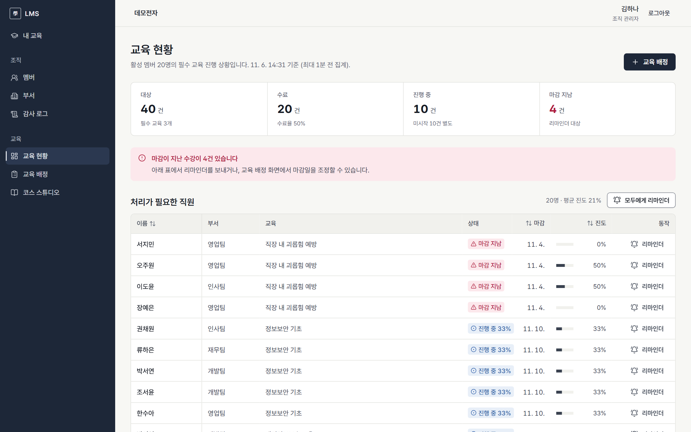
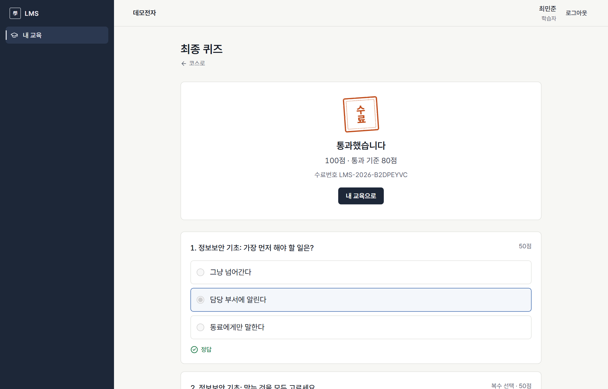
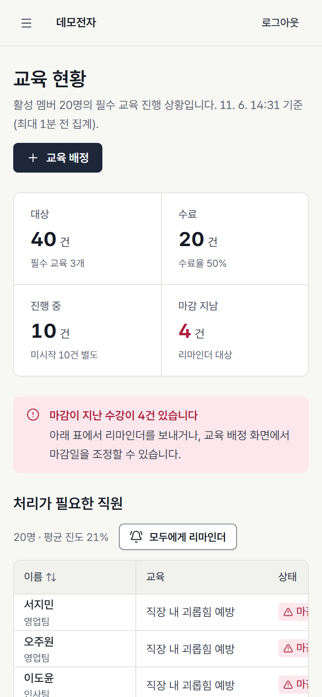
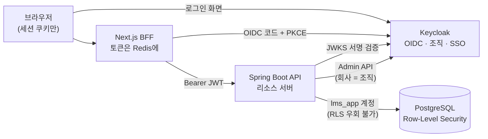
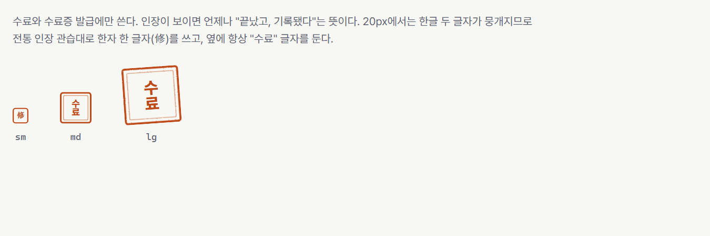

# LMS — B2B 멀티테넌트 사내교육 플랫폼

> 여러 회사가 각자 직원의 **필수 교육을 배정**하고, **누가 들었고 누가 아직인지** 추적하고, 수료를 **진위 확인 가능한 공식 기록**으로 남기는 SaaS형 LMS.

면접을 앞두고 5일 동안 기획부터 설계·구현까지 진행하는 포트폴리오 프로젝트입니다. 기능 수보다 **"현업 표준대로, 모든 선택에 이유가 있게"** 를 목표로 했습니다. 모든 기술 선택에는 검토한 대안과 포기한 것이 [docs/](docs/README.md)에 기록되어 있습니다.



<table>
  <tr>
    <td width="58%"></td>
    <td width="42%"></td>
  </tr>
  <tr>
    <td>학습자: 수료하는 순간 인장이 한 번 찍힙니다</td>
    <td>모바일: 사이드바는 시트로, 표는 첫 열 고정 가로 스크롤</td>
  </tr>
</table>

<sub>실행 중인 앱에서 데모 시드 데이터로 찍은 화면입니다(`cd frontend/e2e && pnpm screenshots`). 회사·사람·수치는 모두 합성 데이터입니다.</sub>

---

## 무엇을 보여주는 프로젝트인가

| 주제 | 핵심 | 근거 |
|---|---|---|
| **멀티테넌트 격리** | 회사 간 데이터 격리를 **앱(Hibernate `@TenantId`)과 DB(PostgreSQL RLS) 두 겹**으로 막고, 테스트로 증명 | [`TenantIsolationIT`](backend/src/test/java/com/lms/TenantIsolationIT.java), [`RowLevelSecurityIT`](backend/src/test/java/com/lms/RowLevelSecurityIT.java) |
| **커넥션 풀 함정** | 풀로 돌아간 커넥션에 이전 회사 정보가 남지 않도록 반납 시 초기화 | [`ConnectionPoolTenantLeakIT`](backend/src/test/java/com/lms/ConnectionPoolTenantLeakIT.java) |
| **표준 인증** | 인증은 직접 만들지 않고 **Keycloak(OIDC)**, 브라우저에는 토큰 대신 세션 쿠키만 두는 **BFF** | [BFF 흐름](docs/05-service-flows.md#1-로그인-bff--keycloak-이메일-우선) |
| **분산 작업의 보상** | 회사 등록 = Keycloak 조직 생성 + DB 저장. 실패하면 조직을 지우는 사가(보상 작업) | [`TenantRegistrationService`](backend/src/main/java/com/lms/tenancy/internal/TenantRegistrationService.java) |
| **모듈 경계** | 모듈러 모놀리스. 모듈이 다른 모듈 내부를 참조하면 빌드 실패 | [`ModularityTest`](backend/src/test/java/com/lms/ModularityTest.java) |
| **동시성은 DB 제약으로** | 중복 배정·이중 제출·동시 수료를 "조회 후 생성" 대신 `ON CONFLICT`, 부분 유니크 인덱스, 조건부 UPDATE로 | [`LearningFlowIT`](backend/src/test/java/com/lms/LearningFlowIT.java), [Day 3 노트](docs/notes/day3.md) |
| **아웃박스 → 큐 → 워커** | 수료증 PDF·메일을 업무 데이터와 같은 트랜잭션으로 기록한 뒤 SQS로. 멱등 소비자, DLQ | [`AsyncFlowIT`](backend/src/test/java/com/lms/AsyncFlowIT.java), [Day 4 노트](docs/notes/day4.md) |
| **디자인 시스템** | 디자인 계약서 [DESIGN.md](DESIGN.md), 토큰 대비 자동 검사, 모든 스토리를 실제 브라우저에서 상호작용·접근성 테스트 | [Storybook 테스트](frontend/packages/ui/vitest.config.ts), [검토 기록](docs/design/reviews/2026-11-06-redesign.md) |

---

## 아키텍처



요청 하나의 흐름: **토큰 서명 검증** → 토큰의 조직을 **우리 DB의 현재 멤버십**으로 확인해 회사·역할 결정 → `@PreAuthorize` → 트랜잭션이 커넥션을 꺼낼 때 `set_config('app.tenant_id')` → Hibernate가 `tenant_id` 조건 자동 추가 → **RLS가 최종 방어**. 자세한 설명은 [docs/03-architecture.md](docs/03-architecture.md)에 있습니다.

느린 일은 요청 밖에서 합니다: 수료·배정·리마인더 이벤트를 **같은 트랜잭션으로 아웃박스 테이블**에 적고, 커밋 후 SQS로 보내면 **워커**가 수료증 PDF(OpenHTMLtoPDF, 한글 폰트 내장)를 만들고 메일을 보냅니다. 영상은 MediaConvert가 HLS 3화질로 바꾸고, 완료는 EventBridge → SQS로 받습니다.

AWS 배포 설계(ECS Fargate, RDS, ElastiCache, SQS, S3/CloudFront, MediaConvert, SES, Terraform)와 비용은 [docs/03](docs/03-architecture.md), [docs/08](docs/08-cost-and-limits.md), [Terraform README](infra/terraform/README.md)에 있습니다. **AWS는 코드와 검증까지만 했고, 시연은 로컬에서 합니다.**

| AWS (코드) | 로컬 (시연) | 같은 점 |
|---|---|---|
| S3 + CloudFront | S3Mock | S3 API |
| SQS (+DLQ) | ElasticMQ | SQS API |
| SES | Mailpit | SMTP |
| ElastiCache Valkey | Valkey | Redis 프로토콜 |
| RDS PostgreSQL | PostgreSQL | 같은 엔진, 같은 RLS |
| MediaConvert | 가짜 변환기(원본 mp4 재생) | `VideoTranscoder` 인터페이스 |

---

## 기술 스택

| 영역 | 선택 | 대표 대안과 고른 이유 |
|---|---|---|
| 백엔드 | **Java 21 · Spring Boot 4 · Spring Modulith** | 국내 백엔드 표준. Modulith로 모듈 경계를 테스트로 강제 |
| 데이터 | **PostgreSQL + JPA(Hibernate) + Flyway** | MySQL 대신 Postgres를 고른 결정적 이유는 RLS |
| 인증 | **Keycloak (Organizations)** | "인증은 직접 만들지 않는다". 이메일 우선 로그인·회사 SSO·MFA를 설정으로 |
| 웹 | **Next.js 16 (App Router) + BFF** | 토큰을 브라우저에 두지 않는 IETF 권장 방식, 서버 컴포넌트로 렌더링 |
| UI | **자체 디자인 시스템 `@lms/ui` (Tailwind v4, Radix)** | shadcn 기본 테마 대신 직접 정한 방향 "인장과 이수증" |
| 디자인 검증 | **Storybook 10 + Vitest(Chromium) + axe** | 접근성 위반이 있으면 테스트 실패 |
| 비동기 | **Spring Modulith 이벤트 레지스트리 + SQS + ShedLock** | 아웃박스를 직접 만들지 않음. Kafka(Debezium)는 이 규모에 과함 |
| 문서 생성 | **Thymeleaf + OpenHTMLtoPDF** | iText는 AGPL. LGPL + HTML/CSS 디자인 + 한글 폰트 내장 |
| 테스트 | **JUnit · Testcontainers(실제 Postgres) · Playwright** | H2에는 RLS가 없어 격리 테스트가 의미 없음. E2E는 목 없이 전체 스택 |
| 에러 형식 | **RFC 9457 Problem Details** | IETF 표준 + `code`, `traceId` 확장 |

전체 결정 기록(ADR 형식): [docs/02-tech-decisions.md](docs/02-tech-decisions.md)

---

## 디자인: "인장과 이수증"



인사팀이 다루는 공문서·결재·이수증의 언어에서 가져온 방향입니다. **수료를 회사의 공식 기록으로** 다룬다는 제품의 핵심을 시각 언어로 옮겼습니다.

- **먹남색 셸**이 브랜드를 지고, **남청 강조색은 화면당 2곳 이하**
- **인주색 인장은 수료와 수료증에만**. 인장이 보이면 언제나 "끝났고, 기록됐다"
- 업무 화면에서 세계관이 빌려주는 것은 색·서체·밀도·대표 연출 하나뿐. 내비게이션과 컨트롤은 표준 그대로
- 한글 조판 규칙(제목 행간 1.3~1.4, 본문 1.7~1.8, 음수 자간 금지, 어절 단위 줄바꿈)

| 문서 | 내용 |
|---|---|
| [DESIGN.md](DESIGN.md) | 색·서체·컴포넌트·상태·접근성 규칙과 각 결정의 이유 |
| [docs/design/REVIEW.md](docs/design/REVIEW.md) | 디자인 검토 기준: CI 검사 → 체크리스트 → 5개 관점 점수 |
| [docs/design/reviews/](docs/design/reviews/2026-11-06-redesign.md) | 검토 기록 (발견한 문제 9건과 조치) |

---

## 테스트

| 범위 | 개수 | 무엇을 증명하나 |
|---|---|---|
| 백엔드 (`./gradlew test`) | 82 | 회사 간 접근 차단(404), RLS가 직접 SQL도 차단, 커넥션 풀 누수 없음, 모든 테넌트 테이블에 RLS 강제, 모듈 경계, 초대 사가, 동시 편집(ETag), 업로드, 배정 멱등성, 인정 시간 경계값, 퀴즈 채점, 아웃박스 → 워커 → PDF·메일, 대시보드 캐시, 감사 로그, 영상 변환 이벤트 |
| 디자인 시스템 (`pnpm --filter @lms/ui test`) | 98 | 모든 스토리를 Chromium에서 실행: 상호작용(`play`) + axe 접근성 검사 |
| E2E (Playwright) | 2 | 로그인(Keycloak) → 레슨 → 퀴즈 → 수료, 관리자 대시보드. 목 없이 로컬 스택 전체 |
| 토큰 대비 (`pnpm --filter @lms/ui check:contrast`) | 28쌍 | DESIGN.md가 쓰는 모든 색 조합이 WCAG 2.2 AA |

지금은 로컬에서 실행합니다. GitHub Actions(PR마다 위 테스트 실행, main 머지 시 배포)는 저장소 토큰 권한 문제로 미뤘고, 배포용 OIDC 역할은 Terraform에 있습니다.

---

## 로컬 실행

필요: Docker Desktop, JDK 21, Node 22+ (corepack으로 pnpm 사용)

1. 인프라 (PostgreSQL, Valkey, Keycloak, Mailpit, S3Mock, ElasticMQ)

```bash
docker compose -f infra/local/docker-compose.yml up -d
```

2. API (http://localhost:8081, Flyway 마이그레이션 자동 적용)

```bash
cd backend && ./gradlew bootRun
```

3. 웹 (http://localhost:3000)

```bash
cd frontend && corepack enable && pnpm install && cp apps/web/.env.example apps/web/.env.local && pnpm --filter web dev
```

4. 디자인 시스템 (http://localhost:6006)

```bash
cd frontend && pnpm --filter @lms/ui storybook
```

5. 데모 데이터 (선택, 한 번만): 회사 2개, 직원 24명, 코스 4개, 진도가 제각각인 수강과 수료증. 끝나면 스스로 종료합니다.

```bash
cd backend && ./gradlew bootRun --args='--lms.seed=true --server.port=0'
```

| 데모 계정 (비밀번호 모두 `Demo-2026-lms`, 로컬 전용) | 역할 |
|---|---|
| `admin@demo-elec.test` | 데모전자 관리자: 교육 현황, 배정, 리마인더, 감사 로그 |
| `instructor@demo-elec.test` | 데모전자 강사: 코스 스튜디오, 퀴즈 |
| `learner@demo-elec.test` | 데모전자 학습자: 학습 → 퀴즈 → 수료증 |
| `admin@demo-trade.test` | 데모물산 관리자: 교차 테넌트 확인 (데모전자가 보이지 않는다) |

시드 없이 시작하면 **회사 등록하기 → Keycloak 회원가입 → 회사 정보 입력** 순서로 첫 관리자가 됩니다. 시연 순서와 데이터 초기화 방법은 [docs/10](docs/10-demo-script.md)에 있습니다.

6. E2E (1~3과 시드가 준비된 상태에서)

```bash
cd frontend/e2e && pnpm exec playwright install chromium && pnpm exec playwright test
```

> 저장소의 비밀번호·클라이언트 시크릿(`*_dev`, `lms-web-dev-secret` 등)은 **로컬 Docker 전용 개발값**입니다. 운영 값은 AWS SSM Parameter Store로 주입하도록 설계되어 있습니다.

| 주소 | 무엇 |
|---|---|
| http://localhost:8080 | Keycloak 관리 콘솔 (admin / admin_dev) |
| http://localhost:8081/swagger-ui.html | API 문서 |
| http://localhost:8025 | Mailpit (개발용 메일함: 초대·배정·리마인더·수료 메일이 여기로 온다) |
| http://localhost:9090 | S3Mock (로컬 S3, 업로드 파일·수료증 PDF 저장소) |
| http://localhost:9325 | ElasticMQ 상태 화면 (로컬 SQS, 큐와 DLQ의 메시지 수) |

---

## 저장소 구조

```
backend/                Spring Boot API
  src/main/java/com/lms/
    shared/             테넌트 컨텍스트, RLS DataSource, 보안 필터, RFC 9457 에러
    shared/messaging/   아웃박스 릴레이, SQS 워커(멱등), 재발행 작업
    tenancy/            회사·사용자·멤버십, Keycloak 연동, 회사 등록(사가), 데모 시드
    organization/       부서
    catalog/            코스·섹션·레슨·퀴즈 (ETag 동시 편집)
    files/              S3 직접 업로드, MediaConvert(HLS), CloudFront 서명 쿠키
    learning/           배정·수강·진도·퀴즈·수료, 수료증 PDF, 리마인더
    records/            xAPI 학습 기록 (추가만 가능)
    notification/       메일 (배정·리마인더·수료)
    reporting/          대시보드 읽기 모델 + 회사별 캐시
    audit/              감사 로그 (이벤트 구독, 추가만 가능)
  src/main/resources/db/migration/   Flyway (테이블, RLS 정책, 권한)
  src/main/resources/templates/      수료증·메일 템플릿 (Thymeleaf)
frontend/               pnpm 워크스페이스
  apps/web/             Next.js — BFF 로그인(PKCE, Redis 세션), 회사 등록, 홈
  packages/ui/          디자인 시스템 + Storybook (컴포넌트, 화면 조립, 스토리 테스트)
  packages/api-client/  OpenAPI → TypeScript 타입 (API와 웹의 계약)
  e2e/                  Playwright (로컬 스택 전체)
infra/
  local/                Docker Compose, DB 역할 초기화, ElasticMQ 큐 설정
  keycloak/             렐름 설정 (코드로 관리)
  terraform/            AWS 배포 코드 (bootstrap + demo 환경 + 모듈 7개)
docs/                   기획·설계 문서, 디자인 문서, 일별 면접 설명 노트
DESIGN.md · PRODUCT.md  디자인 계약서, 제품 요약
.claude/skills/         디자인 작업용 에이전트 스킬 (출처: THIRD_PARTY.md)
```

---

## 진행 상황

5일 계획([docs/07-schedule.md](docs/07-schedule.md))의 구현을 마쳤습니다. AWS는 코드까지, 시연은 로컬입니다.

- [x] 기획·설계 문서 (요구사항, 기술 결정, 아키텍처, 데이터 모델, 서비스 흐름, 보안, 비용)
- [x] Day 1: 멀티테넌트 기반(Keycloak, 앱 + RLS 격리, 회사 등록 사가, 부서), BFF 로그인, 디자인 시스템
- [x] Day 2: 멤버·초대(사가), 코스 스튜디오(ETag/If-Match), S3 직접 업로드(presigned·multipart), OpenAPI → TS 타입
- [x] Day 3: 배정(멱등 키)·신규 입사자 자동 배정, 영상 진도(인정 시간 규칙)·xAPI 기록, 퀴즈(서버 채점)·수료
- [x] Day 4: 아웃박스 → SQS → 워커, 수료증 PDF·진위 확인, 메일, 대시보드(회사별 캐시), 감사 로그, MediaConvert HLS·서명 쿠키, 예약 작업(ShedLock)
- [x] Day 5: 데모 시드(회사 2개), Playwright E2E, 도메인(`bymile.site`)·SES 배포 코드, 예상 질문, 시연 대본
- [x] AWS 배포 코드: Terraform + Dockerfile (`validate`·이미지 빌드까지, 적용은 안 함) — [infra/terraform](infra/terraform/README.md)
- [ ] 미룸: CI/CD(저장소 토큰 권한), 실제 AWS 적용·롤백 리허설, OpenTelemetry·Sentry, `compose --profile full`

---

## 문서

| 문서 | 내용 |
|---|---|
| [01 제품 기획](docs/01-product.md) | 사용자 모델(멤버십), 이메일 우선 로그인, 시나리오, LMS 표준(xAPI·SCORM) |
| [02 기술 결정](docs/02-tech-decisions.md) | 후보 → 선택 → 이유 → 포기한 것 |
| [03 아키텍처](docs/03-architecture.md) | AWS 구성, 요청 생애주기, 멀티테넌트 격리 상세 |
| [04 데이터 모델](docs/04-data-model.md) | ERD와 설계 이유, 동시성 제어 |
| [05 서비스 흐름](docs/05-service-flows.md) | 기능별 시퀀스 다이어그램과 이상 상황 처리 |
| [06 보안](docs/06-security.md) | OWASP Top 10 기준 위협과 대응 |
| [07 일정](docs/07-schedule.md) | 5일 실행 계획과 범위 축소 순서 |
| [08 비용과 한계](docs/08-cost-and-limits.md) | AWS 비용, 시연 한계, 의도적으로 표준에서 벗어난 곳 |
| [09 예상 질문과 답](docs/09-interview-qa.md) | 아키텍처·격리·인증·동시성·인프라·회고 18문항 |
| [10 시연 대본](docs/10-demo-script.md) | 5분 시연, 아키텍처 1분, 리허설 체크리스트 |
| [Day 1 설명 노트](docs/notes/day1.md) | 인증 연결과 멀티테넌트 격리를 내 말로 설명하기 |
| [Day 2 설명 노트](docs/notes/day2.md) | 초대 사가, 코스 동시성, 직접 업로드를 내 말로 설명하기 |
| [Day 3 설명 노트](docs/notes/day3.md) | 배정과 수강, DB 제약 동시성, 인정 시간, xAPI, 배포 코드 |
| [Day 4 설명 노트](docs/notes/day4.md) | 아웃박스, 멱등 소비자, 수료증 PDF, 진위 확인, 캐시 키 격리, HLS·서명 쿠키 |
| [Day 5 설명 노트](docs/notes/day5.md) | 시드, E2E가 찾은 버그, 도메인 위임·SES, 미룬 것 |
| [AWS 배포 코드](infra/terraform/README.md) | Terraform 구조, 설계 결정, 적용 순서, 검증 범위 |

---

## 출처와 감사

- 디자인 규칙 일부: [nexu-io/open-design](https://github.com/nexu-io/open-design) (Apache-2.0) — [docs/design/open-design/](docs/design/open-design/)에 원본과 라이선스 동봉
- 에이전트 스킬: Anthropic `frontend-design`, `pbakaus/impeccable`, Vercel `web-design-guidelines`, `addyosmani/web-quality-skills` — [THIRD_PARTY.md](.claude/skills/THIRD_PARTY.md)
- 글꼴: [Pretendard](https://github.com/orioncactus/pretendard) (OFL-1.1)
