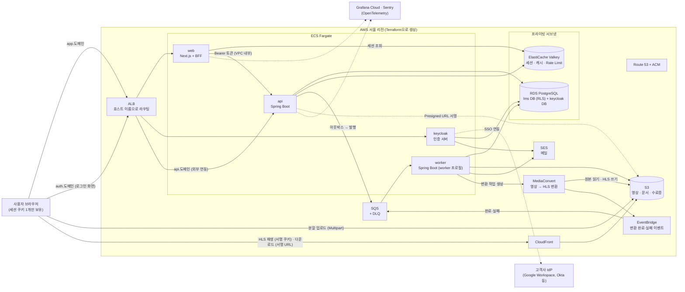
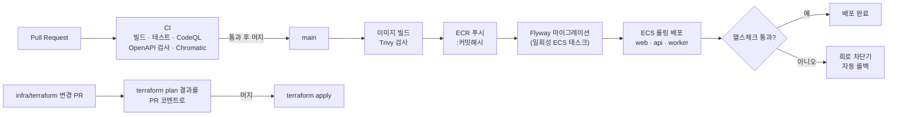
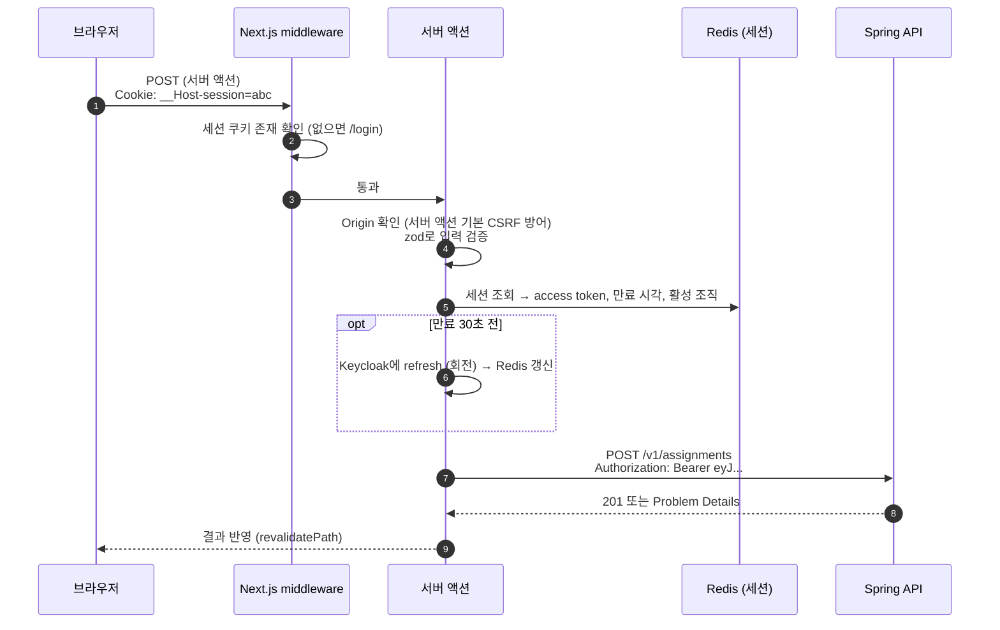
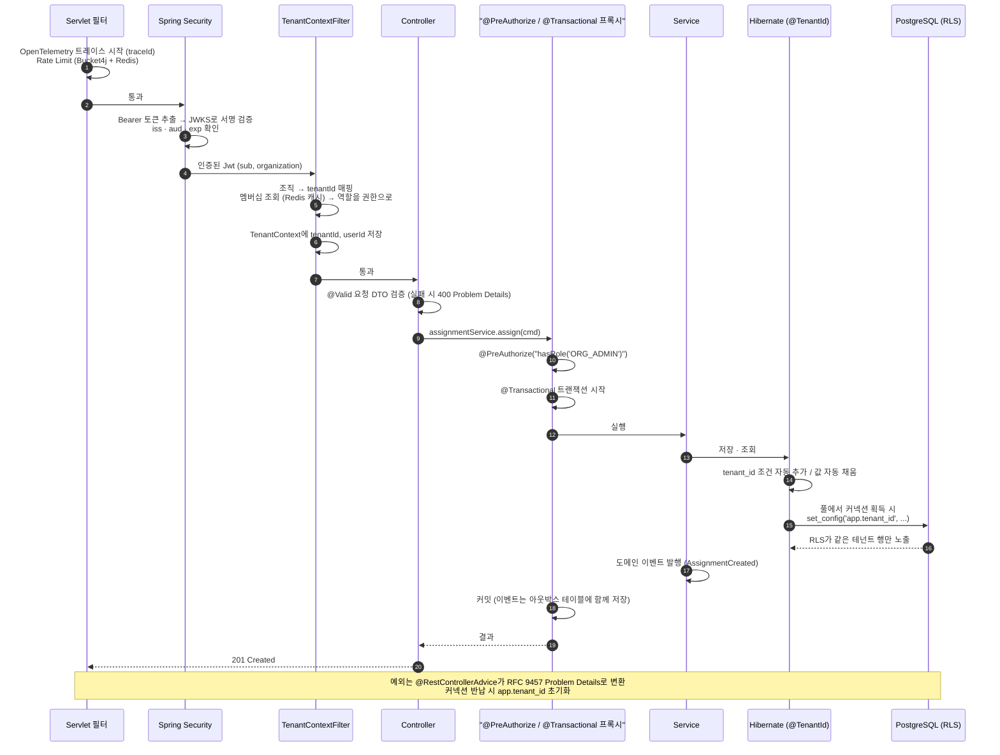
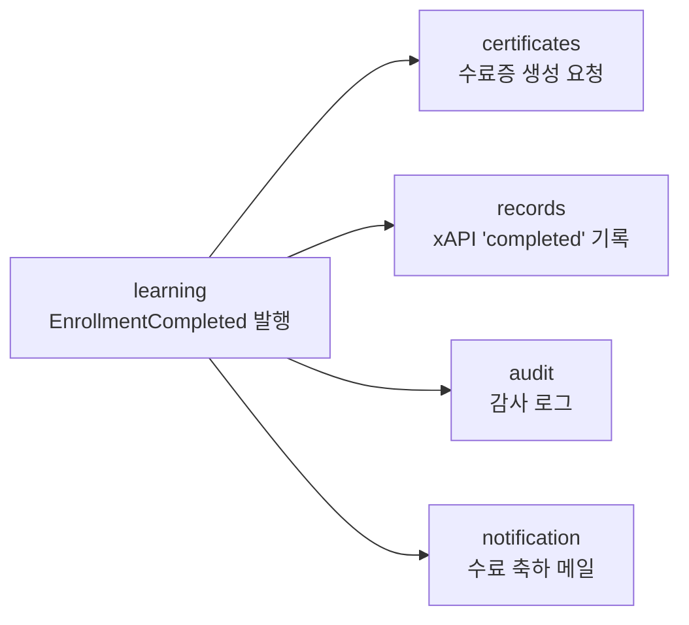

# 03. 아키텍처 — 무엇이 어디서 돌고, 요청은 어떻게 흐르는가

> 각 기술을 고른 이유는 [02-tech-decisions.md](02-tech-decisions.md)에 있다. 이 문서는 **그것들이 어떻게 맞물려 돌아가는지**를 설명한다.

## 1. 시스템 전체 구성도



### 이 그림에서 읽어야 할 핵심 5가지

1. **브라우저에는 토큰이 없다.** 브라우저는 `app.도메인`의 세션 쿠키 하나만 가진다. Access Token은 **Next.js 서버(BFF)가 Redis에 보관**하고, Spring API를 부를 때만 꺼내 쓴다.
2. **인증은 Keycloak, 인가는 Spring.** Keycloak은 "누구인지"를 증명하는 토큰을 발급하고, Spring은 그 토큰을 검증한 뒤 **우리 DB의 멤버십**으로 "무엇을 할 수 있는지"를 판단한다.
3. **파일 바이트는 서버를 거치지 않는다.** 업로드는 S3로 직접(대용량은 분할), 재생은 CloudFront를 통해 직접 받는다. API는 "허락(서명)"만 한다. 영상 변환도 우리 서버가 아니라 **MediaConvert가 S3에서 읽고 S3에 쓴다.**
4. **느린 일은 큐로 보낸다.** API는 수료 처리와 함께 "수료증을 만들어라"라는 이벤트를 **같은 트랜잭션으로 DB에 기록**(아웃박스)하고, 커밋 후 SQS로 발행한다. 워커가 꺼내서 PDF를 만든다. 영상 변환도 같은 구조다. 워커가 MediaConvert에 작업을 맡기고, 완료 알림은 **EventBridge → SQS**로 돌아온다.
5. **DB와 Redis는 인터넷에서 닿을 수 없다.** 프라이빗 서브넷에 있고, 보안 그룹은 ECS 서비스에서 오는 연결만 허용한다.

---

## 2. AWS 배포 구성

### 2.1 네트워크

```
VPC 10.0.0.0/16 (가용 영역 2개: ap-northeast-2a, 2c)
├─ 퍼블릭 서브넷 ×2   ALB, ECS 태스크(퍼블릭 IP, 인바운드는 ALB 보안 그룹만 허용) ⚠️ NAT 비용 절감
└─ 프라이빗 서브넷 ×2  RDS, ElastiCache (인터넷 경로 없음)
```
- 가용 영역을 2개 쓰는 이유: ALB와 RDS 서브넷 그룹이 **최소 2개 가용 영역**을 요구한다. 시연에서는 태스크를 1개씩만 띄우지만, 설정 숫자만 바꾸면 영역별로 분산된다.
- ⚠️ ECS 태스크를 퍼블릭 서브넷에 두는 이유와 운영 시 바꿀 구성은 [02](02-tech-decisions.md) D4, [08](08-cost-and-limits.md)에 있다.

### 2.2 보안 그룹 (누가 누구에게 접속할 수 있나)

| 대상 | 허용하는 인바운드 |
|---|---|
| ALB | 인터넷 → 443 (80은 443으로 리다이렉트) |
| web, api, keycloak | **ALB 보안 그룹에서만** (+ web → api 내부 호출) |
| worker | 없음 (SQS를 가져가기만 함) |
| RDS | api, worker, keycloak 보안 그룹에서만 5432 |
| ElastiCache | web, api, worker 보안 그룹에서만 6379 |

> IP 주소가 아니라 **보안 그룹끼리 참조**한다. 태스크가 재시작해 IP가 바뀌어도 규칙이 유지된다.

### 2.3 ECS 서비스 (시연 규모)

| 서비스 | vCPU / 메모리 | 개수 | 비고 |
|---|---|---|---|
| web | 0.25 / 0.5GB | 1 | Next.js standalone 빌드 |
| api | 0.5 / 1GB | 1 | 가상 스레드 사용, `/actuator/health` 헬스체크 |
| worker | 0.25 / 1GB | 1 | SQS 소비, PDF 생성 |
| keycloak | 0.5 / 1GB | 1 | 최적화 빌드(`start --optimized`), RDS의 별도 DB 사용 |

- **운영이라면** 각 서비스를 2개 이상 띄워 가용 영역에 분산하고, CPU 기준 자동 확장을 건다. Terraform 변수만 바꾸면 된다.
- 비용 계산은 [08-cost-and-limits.md](08-cost-and-limits.md)에 있다.

### 2.4 배포 파이프라인



- GitHub Actions는 **OIDC로 AWS 역할을 잠시 빌린다.** 저장소에 AWS 키가 없다.
- 인프라 변경도 PR에서 `plan` 결과를 리뷰한 뒤에만 적용된다.

---

## 3. 요청 하나의 일생

예시: 관리자가 교육 배정 화면에서 "배정하기"를 누른다.

### 3.1 브라우저 → Next.js (BFF)



### 3.2 Spring 내부



### 3.3 각 단계가 왜 그 자리에 있나

| 순서 | 구성 요소 | 하는 일 | 왜 이 위치인가 |
|---|---|---|---|
| 1 | 트레이싱 필터 | traceId 발급 | 이후 모든 로그·에러에 같은 ID가 붙어야 한다 |
| 2 | Rate Limit 필터 | 요청 수 제한 | 비싼 작업(토큰 검증, DB) 전에 **값싸게 먼저 차단** |
| 3 | Spring Security | **인증**: 토큰이 진짜인가 | 이후 모든 단계가 "누구인지"를 알아야 함 |
| 4 | TenantContextFilter | 테넌트 확정, 역할 로드 | 인증 직후, 비즈니스 로직 전에 컨텍스트를 고정 |
| 5 | Controller `@Valid` | 입력 검증 | 서비스는 **이미 검증된 값만** 받는다 |
| 6 | `@PreAuthorize` | **인가**: 이 역할이 이걸 해도 되나 | 메서드 단위로 선언, 서비스 호출 전에 차단 |
| 7 | `@Transactional` | 트랜잭션 경계 | 서비스 메서드 = 하나의 업무 단위 |
| 8 | Service | 업무 규칙, 소유권 검사 | 테스트의 핵심 대상 |
| 9 | Hibernate `@TenantId` | 테넌트 조건 자동 적용 | 개발자가 잊어도 적용 |
| 10 | RLS | 최종 방어선 | 앱 버그가 있어도 DB가 막음 |
| ✕ | `@RestControllerAdvice` | 예외를 표준 에러로 변환 | 내부 메시지·스택이 밖으로 새지 않게 |

> **면접 포인트 — Spring의 "마법"은 프록시다.** `@Transactional`과 `@PreAuthorize`는 Spring이 서비스 객체를 감싼 **프록시**가 처리한다. 그래서 **같은 클래스 안에서 자기 메서드를 호출하면(self-invocation) 프록시를 거치지 않아 트랜잭션이나 권한 검사가 적용되지 않는다.** 이 함정을 설명할 수 있으면 Spring을 이해한 것이다.

---

## 4. 멀티테넌트 격리 — 3중 방어 상세

### 4.1 원칙
1. **tenantId의 출처는 검증된 토큰의 조직 정보 + 우리 DB의 멤버십뿐이다.** URL, 바디, 헤더의 tenantId는 무시한다.
2. **컨텍스트가 없으면 실패한다(fail-closed).** 테넌트 없이 테넌트 테이블을 조회하면 0건이 아니라 에러다.
3. **앱이 실수해도 DB가 막는다.**

### 4.2 토큰 → 테넌트 결정
```
Access Token (Keycloak 발급)
{
  "iss": "https://auth.도메인/realms/lms",
  "sub": "f3c1...",                 ← Keycloak 사용자 ID → 우리 User.keycloakSub
  "aud": "lms-api",
  "organization": { "acme": { "id": "9a7e..." } },   ← 로그인 시 선택한 조직
  "exp": ...
}
```
1. `organization` 클레임에서 Keycloak 조직 ID를 꺼낸다 → `Tenant.keycloakOrgId`로 우리 tenantId를 찾는다.
2. `(tenantId, userId)`의 **ACTIVE 멤버십이 있는지** 확인한다. 없으면 403.
3. 멤버십의 역할을 Spring Security 권한(`ROLE_ORG_ADMIN` 등)으로 바꾼다.

> **왜 토큰의 조직 정보만 믿지 않고 DB 멤버십을 또 확인하나?** 관리자가 멤버를 비활성화했는데 토큰이 아직 살아 있을 수 있다. 토큰은 "로그인할 때의 사실"이고, 멤버십은 "지금의 사실"이다.

### 4.3 DB 계정 분리
| 계정 | 권한 | 사용처 |
|---|---|---|
| `lms_owner` | 테이블 소유자, DDL, RLS 정책 관리 | Flyway 마이그레이션 태스크만 |
| `lms_app` | DML만. **소유자 아님, BYPASSRLS 없음**. 감사 로그·xAPI 기록은 INSERT만 | api, worker |
| `keycloak` | keycloak DB만 | Keycloak |

> Postgres에서 **테이블 소유자와 슈퍼유저는 RLS를 우회한다.** 앱이 소유자 계정으로 접속하면 RLS가 있어도 소용없다. 추가로 `FORCE ROW LEVEL SECURITY`도 건다.

### 4.4 RLS 정책 (Flyway 마이그레이션)
```sql
ALTER TABLE course ENABLE ROW LEVEL SECURITY;
ALTER TABLE course FORCE ROW LEVEL SECURITY;

CREATE POLICY tenant_isolation ON course
  USING      (tenant_id = current_setting('app.tenant_id', true)::uuid)
  WITH CHECK (tenant_id = current_setting('app.tenant_id', true)::uuid);
```
- 설정이 없으면 `current_setting(..., true)`가 `NULL`이고, `tenant_id = NULL`은 항상 거짓 → **아무 행도 안 보인다.**
- `WITH CHECK`는 다른 테넌트 ID로 쓰는 것을 막는다.
- **CI 테스트:** "`tenant_id` 컬럼이 있는 모든 테이블에 RLS 정책이 있는가"를 시스템 카탈로그로 검사한다. 새 테이블에 정책을 빠뜨리면 빌드가 실패한다.

### 4.5 앱과 DB를 잇는 코드 (구현: `shared/persistence`)
```java
@Entity
class Department extends AbstractEntity {
    @TenantId UUID tenantId;   // 조회 조건 자동 추가 + 저장 시 자동 채움 (Hibernate)
    String name;
}

// 1) Hibernate에게 "지금 테넌트"를 알려준다 (@TenantId용)
class TenantIdentifierResolver implements CurrentTenantIdentifierResolver<UUID> {
    public UUID resolveCurrentTenantIdentifier() {
        return TenantContext.tenantId().orElse(NO_TENANT);   // 없으면 아무와도 일치하지 않는 값
    }
}

// 2) DataSource 자체를 감싼다: 누가 커넥션을 꺼내든(Hibernate, JdbcClient) RLS 설정이 걸린다
class TenantAwareDataSource extends DelegatingDataSource {
    public Connection getConnection() {
        Connection c = super.getConnection();
        // 테넌트가 있으면 set_config('app.tenant_id', ?, false), 없으면 RESET
        return proxyThatResetsOnClose(c);   // ★ 풀로 돌려줄 때 RESET app.tenant_id
    }
}
```
- **처음 설계(Hibernate `MultiTenantConnectionProvider`)에서 바꾼 이유:** 그 확장 지점은 Hibernate가 꺼내는 커넥션에만 적용된다. 대시보드 집계에 쓸 `JdbcClient`는 DataSource에서 직접 커넥션을 꺼내므로 RLS 설정이 빠진다. **DataSource를 감싸면 경로와 상관없이 한 규칙**이 적용된다.
- **커넥션 풀의 함정:** 커넥션은 요청이 끝나면 풀로 돌아가 **다른 회사의 요청이 재사용**한다. 반납할 때 `RESET`을 빠뜨리면 다음 요청이 **이전 회사의 tenant_id를 물려받는** 사고가 난다. `ConnectionPoolTenantLeakIT`가 풀 크기 1로 이걸 검증한다.
- **`NULLIF`가 필요한 이유:** 한 번 쓰인 설정은 `RESET` 후 `NULL`이 아니라 `''`가 된다. 정책은 `NULLIF(current_setting('app.tenant_id', true), '')::uuid`를 쓰는 함수 `app_current_tenant()`로 비교한다.
- 트랜잭션이 커넥션을 꺼낼 때 테넌트가 묶이므로, 테넌트를 바꿔야 하는 코드(회사 등록, 예약 작업)는 **`TenantContext.runAs(tenant, () -> 트랜잭션)`** 순서로 쓴다.

### 4.6 테넌트 컨텍스트가 없는 요청은?
| 요청 | 처리 |
|---|---|
| 회사 등록 (`POST /v1/tenants`) | 로그인은 했지만 아직 소속 회사가 없다. 서비스가 Tenant를 만든 직후 **그 tenantId로 컨텍스트를 명시적으로 열고** 나머지를 처리한다 |
| 수료증 진위 확인 (공개) | 일련번호로 회사를 가로질러 찾아야 한다. **`SECURITY DEFINER` DB 함수** `verify_certificate(serial)`가 이름(마스킹), 코스명, 수료일만 돌려준다. 앱 계정은 테이블이 아니라 이 함수에만 실행 권한을 받는다 |
| 예약 작업 (리마인더 등) | 테넌트 목록을 돌며 **테넌트마다 컨텍스트를 열고** 처리한다 |
| SQS 메시지 처리 | 메시지에 tenantId를 담고, 워커가 처리 시작 시 컨텍스트를 연다 |

**전역 테이블(RLS 없음)은 `tenant`, `app_user` 둘뿐이다.** `app_user`는 이메일과 이름만 있고, 앱은 항상 **멤버십과 조인해서**만 조회한다. 멤버십에는 RLS가 걸려 있으므로 다른 회사 사람은 조인 결과에 나타나지 않는다.

### 4.7 DB 밖의 격리 지점
| 지점 | 방법 |
|---|---|
| S3 | 객체 키를 `tenants/{tenantId}/...`로 시작. 서명 URL 발급 전에 DB(RLS)에서 소유 확인 |
| Redis | 캐시 키에 **반드시 tenantId 포함** (`dash:{tenantId}:departments`) |
| SQS | 메시지 본문에 tenantId, 처리 시 컨텍스트 설정 |
| 로그·트레이스 | 모든 항목에 tenantId 속성 |
| ID | UUID v7 → 추측해서 훑어보기 불가, 시간순이라 인덱스 친화적 |

### 4.8 증명: 교차 테넌트 테스트
```java
@Test
void A회사_관리자는_B회사_코스를_조회할_수_없다() throws Exception {
    mockMvc.perform(get("/v1/courses/{id}", courseOfB.id())
            .with(jwtFor(adminOfA)))           // 테스트용으로 서명한 토큰
        .andExpect(status().isNotFound());     // 403이 아니라 404: 존재 여부도 숨긴다
}

@Test
void RLS는_Hibernate를_우회한_SQL도_막는다() {
    TenantContext.run(tenantA, () ->
        assertThat(jdbc.sql("select count(*) from course where tenant_id = ?")
                       .param(tenantB).query(Long.class).single()).isZero());
}
```

---

## 5. 백엔드 모듈 구조 (Spring Modulith)

```
backend/src/main/java/com/lms/
├─ LmsApplication.java
├─ shared/          TenantContext, ProblemDetail 처리, 공통 타입 (모든 모듈이 사용 가능)
├─ tenancy/         회사(Tenant), Keycloak 조직 연동, 멤버십, 역할 → 권한 변환
├─ organization/    부서, 초대
├─ catalog/         코스, 섹션, 레슨, 퀴즈 문항 (강사 스튜디오)
├─ files/           업로드(단일 PUT · Multipart), 완료 검증, 다운로드 URL
├─ media/           영상 자산, 변환 요청(MediaConvert), 완료 이벤트 처리, 재생 권한(서명 쿠키)
├─ learning/        배정, 수강, 진도, 퀴즈 응시·채점, 수료 판정
├─ records/         xAPI 학습 기록 (LRS)
├─ certificates/    수료증 (생성은 워커)
├─ reporting/       대시보드 집계
├─ audit/           감사 로그
└─ notification/    메일 (SES)
```

**모듈 간 통신 규칙**
- 다른 모듈의 **공개 API(최상위 패키지의 서비스)** 만 호출할 수 있다. 내부 패키지(`learning.internal`)를 참조하면 Modulith 테스트가 실패한다.
- **"무언가가 일어났다"는 이벤트로 알린다.** 예를 들어 수료가 일어나면:


- `learning` 모듈은 수료증, 기록, 메일이 있다는 사실조차 모른다. 새 기능(예: 포인트 지급)은 **이벤트를 구독하는 모듈을 추가**하면 된다.
- 이벤트는 Modulith의 **이벤트 발행 레지스트리(아웃박스)** 에 트랜잭션과 함께 저장된다. 리스너가 실패해도 기록이 남아 재시도된다. 무거운 작업(PDF, 메일)은 리스너가 SQS로 넘긴다.

---

## 6. API 설계

### 6.1 규칙과 이유
| 규칙 | 이유 |
|---|---|
| URL 버전 `/v1` | 고객사 연동 API는 함부로 바꿀 수 없다 |
| 리소스 중심 REST | 예측 가능, OpenAPI 문서화 용이 |
| **커서 페이지네이션** (`?cursor=&size=`) | OFFSET은 뒤로 갈수록 느리고, 데이터가 추가되면 중복·누락. UUID v7은 시간순이라 커서로 적합 |
| **RFC 9457 Problem Details** | 표준 에러 형식 |
| 다른 테넌트 리소스는 404 | 존재 여부 누출 방지 |
| 요청·응답 DTO 분리 | 엔티티 노출 금지 (정답, 내부 필드) |
| 멱등 키(`Idempotency-Key`) | 배정, 퀴즈 제출처럼 재전송되면 안 되는 POST에 적용 (Should) |

### 6.2 BFF 라우트 (Next.js)
| 경로 | 설명 |
|---|---|
| `GET /auth/login` | PKCE 값 생성 → Keycloak 로그인 화면으로 이동 |
| `GET /auth/callback` | 인가 코드 → 토큰 교환 → Redis 세션 생성 → 세션 쿠키 발급 |
| `POST /auth/select-org` | 활성 조직 변경 (해당 조직으로 토큰 재발급) |
| `POST /auth/logout` | Redis 세션 삭제 + Keycloak 로그아웃 |
| `PUT /bff/progress` | 영상 하트비트 (클라이언트 컴포넌트 → BFF → Spring) |

### 6.3 Spring API (MVP)
| 메서드 | 경로 | 권한 | 설명 |
|---|---|---|---|
| GET | `/v1/me` | 로그인 | 내 정보, 소속 조직 목록, 현재 역할 |
| POST | `/v1/tenants` | 로그인 (소속 없어도 됨) | 회사 등록 → Keycloak 조직 생성 + 첫 관리자 멤버십 |
| GET/POST/PATCH/DELETE | `/v1/departments` | ADMIN | 부서 |
| GET | `/v1/members` | ADMIN | 멤버 목록 (부서·상태 필터) |
| PATCH | `/v1/members/{id}` | ADMIN | 역할·부서 변경, 비활성화 |
| POST | `/v1/invitations` | ADMIN | 초대 (Keycloak 조직 초대 + INVITED 멤버십) |
| GET/POST | `/v1/courses` | 로그인 / INSTRUCTOR·ADMIN | 목록 / 생성 |
| GET/PATCH/DELETE | `/v1/courses/{id}` | 권한별 | 상세 / 수정 / 보관 |
| POST | `/v1/courses/{id}/publish` | 소유 강사·ADMIN | 게시 검증 후 게시 |
| POST/PATCH/DELETE | `/v1/courses/{id}/sections[/{sid}]` | 소유 강사 | 섹션 |
| POST/PATCH/DELETE | `/v1/sections/{sid}/lessons[/{lid}]` | 소유 강사 | 레슨 |
| PUT | `/v1/courses/{id}/quiz` | 소유 강사 | 퀴즈·문항 저장 |
| POST | `/v1/files/upload-url` | INSTRUCTOR·ADMIN | 작은 파일(문서·이미지 50MB 이하) Presigned PUT 발급 |
| POST | `/v1/files/{id}/complete` | 업로더 | 업로드 검증 |
| POST | `/v1/uploads` | INSTRUCTOR·ADMIN | 영상 Multipart 업로드 시작 → `{ fileId, uploadId, partSize }` |
| POST | `/v1/uploads/{fileId}/parts` | 업로더 | 조각 번호 목록 → 조각별 Presigned URL (한 번에 최대 N개) |
| POST | `/v1/uploads/{fileId}/complete` | 업로더 | `{ parts: [{ partNumber, etag }] }` → 합치기 + 검증 → 변환 요청 |
| DELETE | `/v1/uploads/{fileId}` | 업로더 | 업로드 취소 (조각 정리) |
| GET | `/v1/videos/{id}` | 소유 강사·ADMIN | 변환 상태 (PROCESSING / READY / FAILED), 길이, 썸네일 |
| POST | `/v1/videos/{id}/retry` | 소유 강사·ADMIN | 실패한 변환 재시도 |
| POST | `/v1/assignments` | ADMIN | 교육 배정 |
| GET | `/v1/assignments` | ADMIN | 배정 목록 |
| POST | `/v1/assignments/{id}/remind` | ADMIN | 미이수자 리마인더 |
| GET | `/v1/me/enrollments` | 로그인 | 내 교육 |
| GET | `/v1/enrollments/{id}/lessons/{lid}` | 수강자 | 레슨 내용 + HLS 주소 + 서명 쿠키 값(BFF가 쿠키로 설정) |
| PUT | `/v1/enrollments/{id}/lessons/{lid}/progress` | 수강자 | 진도 하트비트 |
| POST | `/v1/enrollments/{id}/lessons/{lid}/complete` | 수강자 | 문서·텍스트 레슨 완료 |
| GET | `/v1/quizzes/{id}` | 수강자 | 문항 (**정답 제외**) |
| POST | `/v1/quizzes/{id}/attempts` | 수강자 | 응시 시작 |
| POST | `/v1/attempts/{id}/submit` | 응시자 | 제출 → 채점 |
| GET | `/v1/me/certificates` | 로그인 | 내 수료증 |
| GET | `/v1/certificates/{id}/download` | 본인·ADMIN | 다운로드 URL |
| GET | `/v1/public/certificates/{serial}` | 공개 | 진위 확인 |
| GET | `/v1/reports/summary` · `/departments` · `/overdue` | ADMIN | 대시보드 |
| GET | `/v1/xapi/statements` | ADMIN · 외부 연동 | xAPI 기록 조회·내보내기 (LRS 조회 API의 부분 구현) |
| GET | `/v1/audit-logs` | ADMIN | 감사 로그 |
| GET | `/actuator/health` | 내부 | ALB 헬스체크 |

Swagger UI(`/swagger-ui`)는 로컬과 스테이징에서만 켠다. 운영에서는 OpenAPI JSON을 CI 산출물로만 공개한다.

---

## 7. 관측성

| 무엇 | 어떻게 | 왜 |
|---|---|---|
| 트레이스 | OpenTelemetry: 브라우저 요청 → Next.js → Spring → DB 쿼리까지 하나의 traceId | "어디서 느린가"를 한 화면에서 본다 |
| 메트릭 | JVM, HTTP 지연·에러율, Hikari 커넥션 풀, SQS 대기 메시지 수 | 용량 계획, 알림 기준 |
| 로그 | JSON 로그 → CloudWatch Logs, `traceId`·`tenantId`·`userId` 포함, 민감 필드 마스킹 | 사고 추적 |
| 에러 | Sentry (프론트·백) | 예외를 사용자·릴리스 단위로 묶어 본다 |
| 알림 | ALB 5xx 비율, ECS 태스크 재시작, DLQ 메시지 발생, **예산 초과** → 메일 | 장애·과금을 사람보다 먼저 안다 |
| 헬스체크 | `/actuator/health` (DB, Redis 포함) → ALB와 ECS가 비정상 태스크를 교체 | 자가 복구 |
