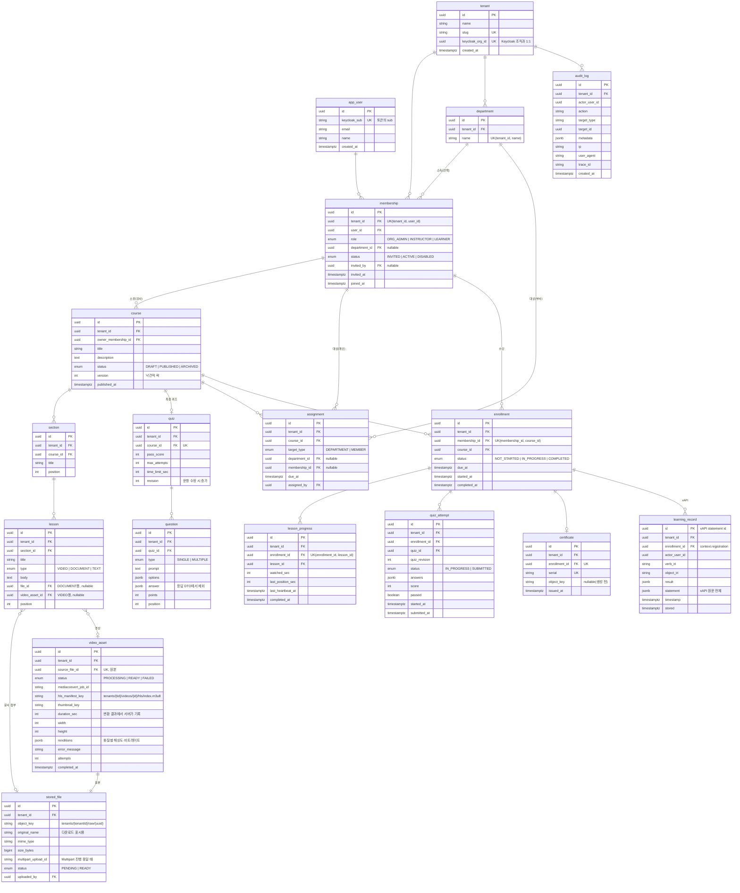

# 04. 데이터 모델 — 테이블과 그렇게 설계한 이유

> 이름 규칙: PostgreSQL 관례에 따라 **snake_case**를 쓴다(Spring Boot의 기본 명명 전략이 Java의 camelCase를 자동 변환한다).
> 비밀번호, MFA, 로그인 세션은 **Keycloak이 소유**한다. 우리 DB에는 없다.

## 1. ERD

**프레임워크가 만드는 보조 테이블**
| 테이블 | 만든 쪽 | 용도 |
|---|---|---|
| `event_publication` | Spring Modulith | **트랜잭셔널 아웃박스**. 모듈 이벤트와 처리 완료 여부 |
| `shedlock` | ShedLock | 예약 작업이 서버 한 대에서만 돌도록 하는 락 |
| `flyway_schema_history` | Flyway | 적용된 마이그레이션 기록 |

---

## 2. 설계 결정과 이유

### 2.1 전역 사용자 + 멤버십 (`app_user`, `membership`)
- 사람은 `app_user` 한 명, 회사별 소속·역할·부서는 `membership`에 둔다. **한 사람이 여러 회사에 속할 수 있다**(외부 강사, 계열사 겸직).
- 교육 관련 테이블(`enrollment`, `assignment`, `course.owner`)은 `app_user`가 아니라 **`membership`을 참조**한다. "누가"가 아니라 **"어느 회사의 누가"** 가 수강한 것이기 때문이다. 같은 사람이 A회사와 B회사에서 같은 코스를 들어도 기록이 섞이지 않는다.
- `app_user`는 테넌트에 속하지 않는 **전역 테이블**이라 RLS가 없다. 그래서 앱은 `app_user`를 단독으로 조회하지 않고 **항상 RLS가 걸린 `membership`과 조인**한다([03](03-architecture.md) §4.6).
- `app_user.keycloak_sub`: 처음 로그인할 때 토큰의 `sub`로 행을 만든다(Just-in-Time 프로비저닝). 이메일과 이름은 로그인할 때마다 토큰 값으로 갱신한다.

### 2.2 초대는 `membership.status = INVITED`
- 별도 초대 테이블 대신 **멤버십을 INVITED 상태로 미리 만든다.** 역할과 부서를 초대 시점에 정해둘 수 있다.
- 초대 메일과 링크, 가입 화면은 **Keycloak 조직 초대 기능**이 처리한다. 초대받은 사람이 처음 로그인하면 이메일로 INVITED 멤버십을 찾아 ACTIVE로 바꾸고, 부서 배정을 동기화한다([05](05-service-flows.md) §3).
- 이전 설계의 초대 토큰 해시, Refresh Token 테이블은 **Keycloak으로 넘어가서 사라졌다.** "직접 만들지 않는다"의 효과다.

### 2.3 모든 테넌트 테이블에 `tenant_id` (자식 테이블까지)
- `lesson`은 `section → course`를 따라가면 테넌트를 알 수 있지만, 그래도 `tenant_id`를 **중복 저장**한다.
- **이유:** RLS 정책과 Hibernate `@TenantId`는 **행 자체의 컬럼**으로 판단해야 단순하고 빠르다. 부모를 조인하는 정책은 느리고 실수하기 쉽다. 정규화보다 격리의 단순함을 택했다.
- 어긋날 위험은 `@TenantId`(자동 채움)와 RLS `WITH CHECK`(다른 값 거부)가 막는다.

### 2.4 배정(`assignment`)과 수강(`enrollment`) 분리
- **assignment** = "개발팀에 이 코스를 3/31까지"라는 **관리자의 의도**
- **enrollment** = "이 멤버가 이 코스를 듣는다"는 **개인 단위 사실**
- 부서 배정 하나가 수십 명의 수강으로 펼쳐지고, 신규 입사자는 **활성 배정**을 보고 수강을 새로 만든다.
- `(membership_id, course_id)` 유니크 제약: 부서 배정과 개인 배정이 겹쳐도 수강은 하나다. 마감일은 **더 이른 날짜**를 따른다.

### 2.5 "마감 지남"은 저장하지 않고 계산
- `due_at < now() AND status <> 'COMPLETED'`로 **조회 시점에 계산**한다. 저장하면 자정마다 상태를 바꾸는 배치가 필요하고, 실패하거나 마감일이 바뀌면 데이터가 틀어진다.
- `(tenant_id, status, due_at)` 복합 인덱스로 대시보드를 빠르게 한다.

### 2.6 현재 상태(`lesson_progress`)와 학습 기록(`learning_record`) 분리
| | `lesson_progress` | `learning_record` (xAPI) |
|---|---|---|
| 성격 | **현재 상태** — 덮어쓴다 | **사건 기록** — 추가만 한다 |
| 용도 | 화면 표시(진도율, 이어보기) | 감사, 분석, 외부 LRS 내보내기 |
| 크기 | 수강 × 레슨 | 계속 늘어남 |
| 권한 | `lms_app` UPDATE 가능 | `lms_app` **INSERT만** |

- xAPI 원문(`statement`) 전체를 JSONB로 보관하고, 자주 거르는 값(`verb_iri`, `object_iri`, `timestamp`)은 컬럼으로 뽑아 인덱스를 건다.
- `id`는 xAPI 규격의 statement ID(UUID)를 그대로 쓴다. 같은 기록이 두 번 들어오면 **기본 키 충돌로 중복이 막힌다**(멱등성).
- 영상 하트비트(15초)를 전부 xAPI로 남기면 너무 많아진다. **`progressed`는 25% 단위 구간을 넘을 때만** 기록한다.
- 기록이 쌓이면 월 단위 **파티셔닝**(`timestamp` 기준)을 적용한다(이번 범위 밖).

### 2.6-1 원본 파일(`stored_file`)과 영상 자산(`video_asset`) 분리
- **원본**은 강사가 올린 파일 그대로다(`raw/`). **영상 자산**은 원본에서 만든 재생용 결과물(HLS 여러 화질, 썸네일, 길이)과 변환 상태다.
- **이유**
  1. 변환은 **실패하거나 다시 할 수 있다**(설정 변경, 화질 추가). 원본을 보관해야 재변환할 수 있다.
  2. 변환 상태(`PROCESSING → READY / FAILED`)는 원본 업로드 상태(`PENDING → READY`)와 **생명주기가 다르다.**
  3. 레슨은 "어떤 파일"이 아니라 **"재생 가능한 영상"** 을 가리켜야 한다. 그래서 `lesson.video_asset_id`를 둔다.
- **영상 길이(`duration_sec`)는 `video_asset`에만 있다.** 이전 설계처럼 강사가 입력하거나 브라우저가 보고하면 진도 계산을 조작할 수 있다. 변환 결과에서 서버가 기록한 값만 믿는다.
- 변환 상태 변경은 `UPDATE ... WHERE status = 'PROCESSING'` 조건부 갱신이다. 완료 이벤트가 두 번 와도(최소 한 번 전달) 한 번만 반영된다.

### 2.7 퀴즈 문항은 JSONB, 응시는 시점 스냅샷
- 보기 개수와 유형이 문항마다 다르므로 `options`, `answer`를 JSONB로 저장한다. `answer`는 **응답 DTO에 아예 없다.**
- 강사가 문항을 고치면 `quiz.revision`이 올라간다. 응시는 시작할 때의 `quiz_revision`을 기록하고, 제출한 답(`answers`)과 채점 결과를 그대로 남긴다. **과거 응시 기록은 당시 기준으로 보존**된다(분쟁 대응).

### 2.8 동시성 제어
| 상황 | 방법 | 이유 |
|---|---|---|
| 두 강사가 같은 코스를 동시에 편집 | `course.version` **낙관적 락**(JPA `@Version`) | 나중에 저장한 쪽이 409를 받아 덮어쓰기 사고를 막는다. 충돌이 드물어서 비관적 락(행 잠금)보다 적합 |
| 퀴즈 중복 제출 | `UPDATE ... WHERE status = 'IN_PROGRESS'` 조건부 갱신 | 갱신된 행이 0개면 이미 제출된 것 |
| 중복 수강 생성 | `(membership_id, course_id)` 유니크 제약 + 충돌 무시 | "조회 후 생성"은 동시 요청에서 깨진다. DB 제약에 맡긴다 |
| 초대 동시 수락 | `UPDATE membership SET status='ACTIVE' WHERE status='INVITED'` | 하나만 성공 |

### 2.9 감사 로그는 추가만 가능
- `lms_app` 계정에서 `audit_log`, `learning_record`의 **UPDATE·DELETE 권한을 회수**한다. 앱이 뚫려도 흔적을 지울 수 없다.
- 기록 대상: 회사 등록, 역할 변경, 멤버 비활성화, 초대, 배정, 코스 게시·보관, 수료, 수료증 발급, 감사 로그 조회 자체.
- `trace_id`를 남겨 감사 로그 ↔ 애플리케이션 트레이스를 연결한다.
- **보관 기간 정책**을 둔다(개인정보 접속기록 보관 의무 고려). 운영이라면 오래된 로그를 S3(객체 잠금)로 옮긴다.

### 2.10 삭제 정책
| 대상 | 방식 | 이유 |
|---|---|---|
| course | `ARCHIVED` (소프트) | 수강·수료 기록이 참조 |
| membership | `DISABLED` (소프트) | 퇴사자의 수료 이력은 감사 대상 |
| DRAFT 코스의 section, lesson | 실제 삭제 | 아무도 수강하지 않음 |
| PENDING 파일 (24시간 경과) | 예약 작업이 S3와 DB에서 삭제 | 업로드 중 이탈한 고아 파일 |
| 미완료 Multipart 조각 | **S3 수명 주기 규칙**: 1일 후 자동 중단 | 보이지 않지만 저장 요금이 나온다 |
| 영상 원본(`raw/`) | 30일 후 저렴한 저장 등급으로 이동 (수명 주기 규칙) | 재변환용으로 보관하되 자주 읽지 않는다 |
| 레슨에서 빠진 영상 자산 | 게시된 코스에서 쓰인 적 없으면 삭제, 쓰인 적 있으면 보관 | 과거 수강 기록의 재생 근거 |

### 2.11 ID는 UUID v7
- 순차 정수 ID는 URL로 다른 리소스를 **추측해 훑어보기**(IDOR)가 쉽다. UUID는 불가능하다.
- v7은 앞부분이 시간이라 **생성 순서대로 정렬**된다. 무작위 v4는 B-tree 인덱스 곳곳에 끼어들어 쓰기 성능이 떨어진다. v7은 끝에 붙으므로 인덱스 친화적이고, 커서 페이지네이션에 그대로 쓸 수 있다.

### 2.12 주요 인덱스
| 인덱스 | 사용처 |
|---|---|
| `membership(tenant_id, user_id)` UNIQUE | 요청마다 멤버십 확인 |
| `app_user(keycloak_sub)` UNIQUE | 토큰 → 사용자 |
| `tenant(keycloak_org_id)` UNIQUE | 토큰 → 테넌트 |
| `enrollment(membership_id, course_id)` UNIQUE | 중복 수강 방지 |
| `enrollment(tenant_id, status, due_at)` | 마감 임박, 미이수 |
| `lesson_progress(enrollment_id, lesson_id)` UNIQUE | 진도 upsert |
| `assignment(tenant_id, department_id)` | 신규 입사자 자동 배정 |
| `learning_record(tenant_id, timestamp DESC)` | xAPI 조회 |
| `audit_log(tenant_id, created_at DESC)` | 감사 로그 최신순 |
