# 05. 서비스 흐름 — 각 기능이 실제로 어떻게 동작하는가

> 각 흐름은 **시퀀스 다이어그램 → 단계별 설명 → 엣지 케이스** 순서다.
> 면접에서는 정상 흐름보다 **"이상 상황에서 어떻게 되나요?"** 를 더 많이 묻는다.

목차
1. 로그인 (BFF + Keycloak, 이메일 우선)
2. 회사 등록
3. 직원 초대와 첫 로그인
4. 세션 유지, 토큰 갱신, 로그아웃
5. 기업 SSO 연결 (Should)
6. 코스 제작과 대용량 업로드 (Multipart)
6-1. 영상 변환 (MediaConvert → HLS)
7. 교육 배정과 신규 입사자
8. 학습, 영상 진도, xAPI 기록
9. 퀴즈 응시, 채점, 수료
10. 수료증 생성 (아웃박스 → SQS → 워커)
11. 관리자 대시보드
12. 예약 작업

---

## 1. 로그인 (BFF + Keycloak, 이메일 우선)

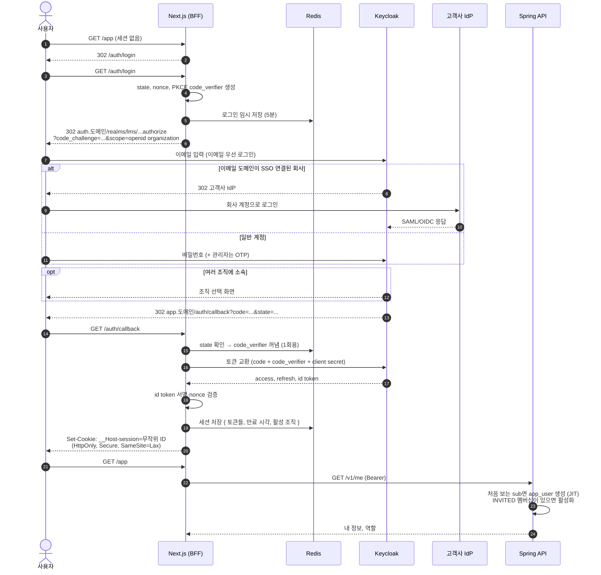

**각 장치가 막는 공격**
| 장치 | 막는 것 |
|---|---|
| `state` | 공격자가 자기 인가 코드를 피해자 브라우저에 주입하는 **로그인 CSRF** |
| `nonce` | ID 토큰 **재사용(replay)** |
| **PKCE** (`code_verifier`) | 인가 코드가 중간에서 **탈취돼도** 토큰으로 교환하지 못하게 함 |
| Confidential client (client secret) | BFF만 토큰을 교환할 수 있음 (브라우저 앱은 비밀값을 숨길 수 없지만 서버는 가능) |
| `__Host-` 쿠키 접두사 | 하위 도메인이 쿠키를 덮어쓰는 것을 브라우저가 막음 (Secure, Path=/, Domain 없음 강제) |
| 로그인 후 세션 ID 새로 발급 | **세션 고정 공격** |

**엣지 케이스**
| 상황 | 처리 |
|---|---|
| 소속 조직이 하나도 없음 | `/onboarding`: "회사를 등록하거나 초대를 기다리세요" |
| 멤버십이 DISABLED | Spring이 403 → BFF가 세션 삭제 후 안내 |
| callback의 state 불일치 | 400, 임시 저장값 삭제 (재시도 불가) |

---

## 2. 회사 등록

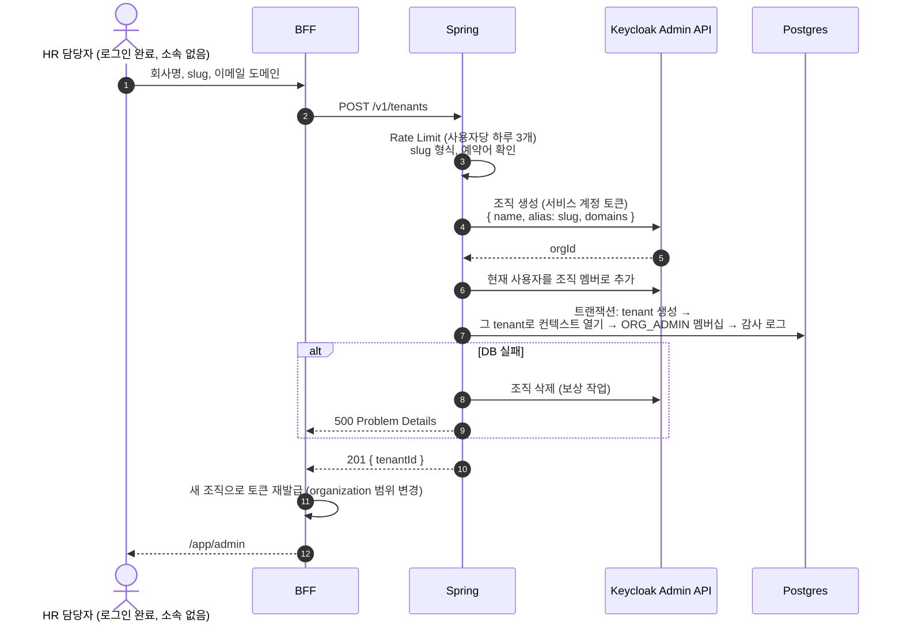

**설명**
- Keycloak과 우리 DB는 **서로 다른 시스템이라 하나의 트랜잭션으로 묶을 수 없다.** 그래서 ① 되돌리기 쉬운 쪽(Keycloak 조직 생성)을 먼저 하고 ② DB가 실패하면 **보상 작업**(조직 삭제)으로 되돌린다. 분산 시스템에서 쓰는 **사가(Saga) 패턴**의 가장 작은 형태다.
- 보상 작업도 실패하면? 로그와 알림을 남기고, 매일 도는 정합성 점검 작업이 "DB에 없는 Keycloak 조직"을 찾아 정리한다.
- **이메일 도메인 검증**(그 도메인의 소유자인지 DNS TXT 레코드로 확인)은 SSO 자동 라우팅을 켜기 전에 필요하다. 남의 도메인을 등록해 그 회사 직원의 로그인을 가로채는 것을 막기 위해서다. 이번엔 Should다.

---

## 3. 직원 초대와 첫 로그인

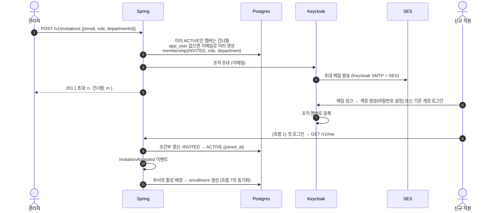

**설명**
- 초대 메일, 링크 서명, 만료, 가입 화면은 **Keycloak이 처리**한다. 우리는 "어떤 역할과 부서로 초대했는지"만 멤버십에 기록한다.
- 첫 로그인에서 `INVITED → ACTIVE`는 `WHERE status = 'INVITED'` 조건부 갱신이라 동시 로그인에도 한 번만 처리된다.

**엣지 케이스**
| 상황 | 처리 |
|---|---|
| 초대받지 않은 사람이 조직 링크를 얻음 | Keycloak 조직 멤버가 아니면 토큰에 그 조직이 없다 → 우리 멤버십도 없다 → 접근 불가 |
| 이미 다른 회사에 소속된 사람을 초대 | 같은 `app_user`에 멤버십만 추가된다 (전역 사용자 모델의 장점) |
| 초대 취소 | INVITED 멤버십 삭제 + Keycloak 조직에서 제거 |

---

## 4. 세션 유지, 토큰 갱신, 로그아웃

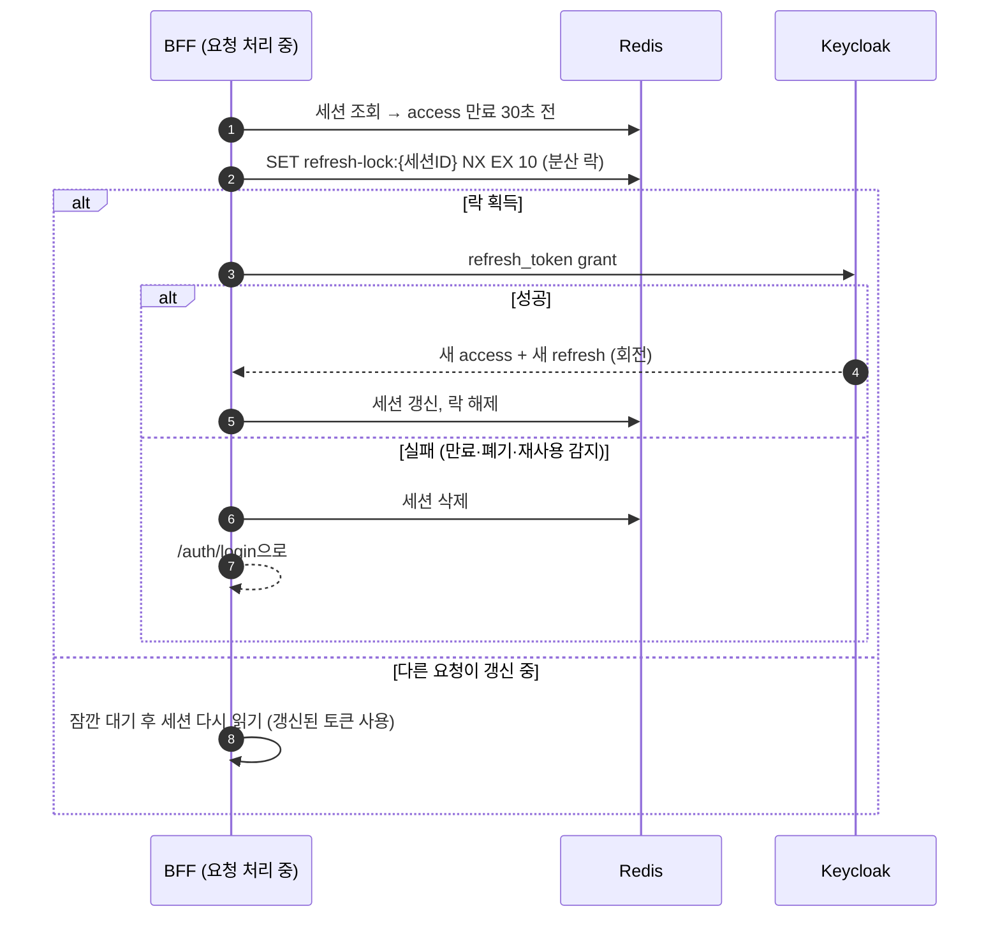

**설명**
- 토큰 갱신은 **BFF 서버 안에서만** 일어난다. 브라우저는 아무것도 모른다.
- **Refresh Token 회전 + 재사용 감지**는 Keycloak 설정("Revoke Refresh Token")으로 켠다. 훔친 Refresh Token이 한 번이라도 다시 쓰이면 Keycloak이 해당 세션을 폐기한다.
- **분산 락이 필요한 이유:** 한 페이지가 서버 컴포넌트 여러 개를 동시에 렌더링하면, 같은 세션의 갱신이 동시에 여러 번 일어난다. 회전 방식에서는 두 번째 갱신이 "재사용"으로 오인돼 **정상 사용자가 로그아웃**된다. Redis 락으로 한 번만 갱신한다.

**로그아웃**
1. BFF: Redis 세션 삭제 → 쿠키 삭제
2. Keycloak 세션 종료(RP-Initiated Logout) → 같은 Keycloak 세션을 쓰는 다른 앱에서도 로그아웃
3. (Should) **Back-Channel Logout:** 관리자가 Keycloak에서 사용자 세션을 끊으면, Keycloak이 BFF에 서버 대 서버로 알리고 BFF가 해당 Redis 세션을 삭제한다.

**멤버 비활성화 시 즉시 차단:** Spring이 요청마다 멤버십 상태를 확인하므로(캐시 60초, 비활성화 시 즉시 삭제) 토큰이 남아 있어도 **다음 요청부터 403**이다.

---

## 5. 기업 SSO 연결 (Should)

1. 관리자가 `/app/admin/sso`에서 회사 IdP 정보(OIDC 발급자 URL, 클라이언트 ID·시크릿 또는 SAML 메타데이터)를 입력한다.
2. Spring이 Keycloak Admin API로 **Identity Provider를 만들어 해당 조직에 연결**하고, 조직 도메인(`acme.com`)에 대해 자동 리디렉션을 켠다.
3. 이후 `@acme.com` 사용자가 이메일을 입력하면 Keycloak이 **곧바로 회사 IdP로 보낸다**(흐름 1의 alt).
4. 처음 들어온 SSO 사용자는 Keycloak이 자동으로 조직 멤버로 만들고, 우리 쪽에서는 기본 역할 `LEARNER`로 멤버십을 만든다(JIT).

**시연 방법:** Keycloak에 렐름을 하나 더 만들어 "ACME 사내 IdP"로 꾸민다. 실제 고객사 IdP(Okta, Entra ID) 없이 **SSO 흐름 전체**를 보여줄 수 있다.

---

## 6. 코스 제작과 대용량 업로드 (Multipart)

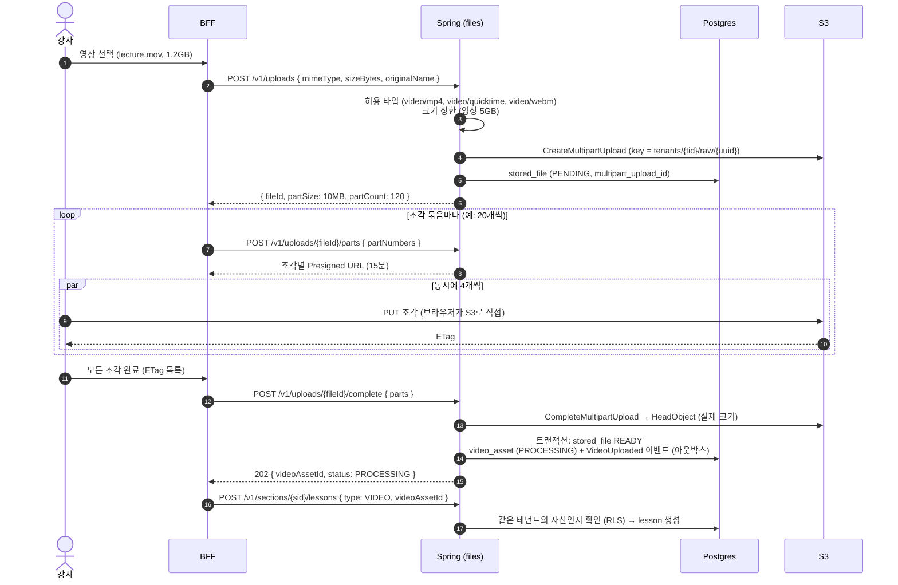

**설명**
- **조각으로 나누는 이유:** 1.2GB를 한 번에 보내다 95%에서 끊기면 처음부터 다시 해야 한다. 10MB 조각이면 **실패한 조각만 다시** 보낸다. 조각을 동시에 4개씩 보내 속도도 빨라진다. 업로드 상태(받은 ETag 목록)를 브라우저에 저장해 두면 **새로고침 후 이어 올리기**도 된다.
- **조각별 URL을 묶음으로 발급하는 이유:** 120개를 한 번에 발급하면 마지막 조각을 보낼 때쯤 URL이 만료될 수 있다. 필요할 때마다 20개씩 받는다.
- S3 CORS는 `app.도메인`의 `PUT`만 허용하고, **`ETag` 응답 헤더를 노출**한다. 이게 빠지면 브라우저가 ETag를 읽지 못해 완료 요청을 만들 수 없다.
- **업로드 완료(202 Accepted)와 재생 가능은 다르다.** 변환이 끝나기 전까지 레슨은 "처리 중"으로 보이고, 코스를 게시할 수 없다.
- 객체 키에 원래 파일명을 쓰지 않는다(UUID). 원래 파일명은 `original_name`에만 저장한다.
- 문서·이미지(50MB 이하)는 Presigned PUT 한 번으로 올린다(`/v1/files/upload-url`). 작은 파일까지 분할하면 요청만 늘어난다.

**엣지 케이스**
| 상황 | 처리 |
|---|---|
| 업로드 중 브라우저 닫음 | 조각은 S3에 남지만 **수명 주기 규칙이 1일 후 자동 정리**. DB의 PENDING 행은 예약 작업이 정리 |
| 강사가 취소 | `DELETE /v1/uploads/{fileId}` → `AbortMultipartUpload` |
| 보고한 크기와 실제 크기가 다름 | 객체 삭제 + 422 |
| 영상이 아닌 파일을 `video/mp4`로 위장 | MediaConvert가 입력을 읽지 못해 **변환 실패(FAILED)** → 강사에게 "영상 파일을 확인하세요" |

**게시(`publish`) 검증:** 레슨 1개 이상, **모든 VIDEO 레슨의 영상 자산이 READY**, 퀴즈가 있다면 모든 문항에 정답 지정. 게시 후 **수강자가 있는 레슨은 삭제 불가**(진도 보호).

**동시 편집:** 두 강사가 같은 코스를 동시에 저장하면 `@Version` 낙관적 락으로 나중 쪽이 409를 받는다.

---

## 6-1. 영상 변환 (MediaConvert → HLS)

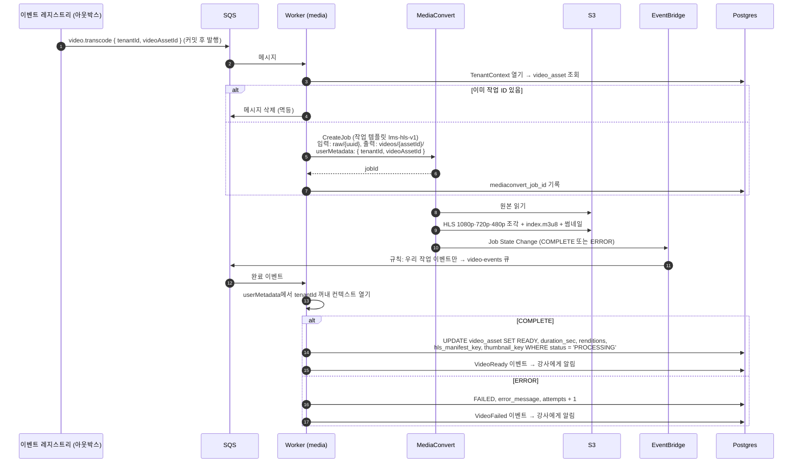

**설명**
- **왜 API가 직접 MediaConvert를 부르지 않고 아웃박스 → SQS → 워커를 거치나:** "업로드 완료 기록"과 "변환 요청"이 원자적이어야 한다. API가 커밋 후 직접 부르다 실패하면 영상이 영원히 PROCESSING에 머문다. 이벤트를 커밋과 함께 저장해 두면 **반드시 한 번 이상** 변환이 요청된다.
- **완료를 어떻게 아나 — 폴링 대신 이벤트:** 워커가 "끝났어?"를 몇 초마다 묻지 않는다. MediaConvert가 상태 변화를 **EventBridge**로 내보내고, 규칙이 그 이벤트를 **SQS**로 보낸다. 워커는 다른 메시지처럼 받으면 된다. 큐를 거치므로 워커가 잠시 죽어 있어도 이벤트를 잃지 않는다.
- **테넌트 정보를 작업에 실어 보낸다(`userMetadata`):** 완료 이벤트에는 우리 DB 정보가 없다. 작업을 만들 때 `tenantId`, `videoAssetId`를 메타데이터로 붙여 두면 이벤트에 그대로 돌아온다. 워커는 이 값으로 RLS 컨텍스트를 연다.
- **영상 길이와 해상도는 변환 결과(완료 이벤트의 출력 정보)에서 기록한다.** 강사 입력은 없다.
- **권한(IAM):** MediaConvert는 원본 경로 읽기와 출력 경로 쓰기만 가능한 **전용 서비스 역할**로 동작한다. 워커의 태스크 역할에는 "작업 생성 + 그 역할을 넘겨줄 권한(`iam:PassRole`)"만 준다.
- **변환을 `VideoTranscoder` 인터페이스 뒤에 둔다.** 로컬 개발과 테스트에서는 "바로 READY로 만드는 가짜 구현"을 쓰고, 나중에 비용 때문에 ffmpeg 워커로 바꿀 때 이 구현만 교체한다.

**엣지 케이스**
| 상황 | 처리 |
|---|---|
| 변환 실패 (손상 파일, 지원 안 되는 코덱) | FAILED + 원인 메시지 → 강사가 `/v1/videos/{id}/retry` 또는 다른 파일 업로드 |
| 완료 이벤트가 두 번 옴 | 조건부 UPDATE로 한 번만 반영 |
| 완료 이벤트가 유실됨 (드묾) | 예약 작업이 **1시간 넘게 PROCESSING인 자산**의 작업 상태를 MediaConvert에 직접 조회해 맞춘다 |
| 원본이 720p | 원본보다 큰 화질(1080p)은 만들지 않는다 |
| 같은 영상을 두 레슨에 사용 | 같은 `video_asset`을 참조 (재변환 없음) |

**시간과 비용 감:** 30분짜리 강의는 변환에 보통 몇 분이 걸린다. 비용은 출력 영상 분당 과금이라 [08](08-cost-and-limits.md)의 "사용량 비례 비용"을 참고한다.

---

## 7. 교육 배정과 신규 입사자

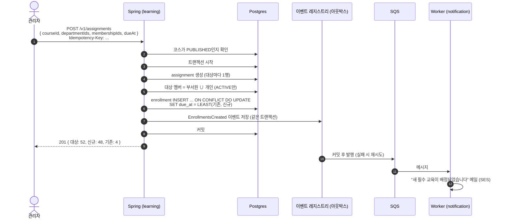

**설명**
- **`ON CONFLICT`로 중복을 DB에 맡긴다.** "이미 있나 조회 → 없으면 INSERT"는 동시 요청에서 둘 다 "없음"으로 판단해 깨진다.
- **메일 발송은 트랜잭션 밖에서**, 그러나 **유실 없이** 일어난다. 이벤트가 아웃박스에 커밋과 함께 저장되기 때문이다. 롤백되면 이벤트도 사라지므로 "배정은 실패했는데 메일만 감"도 없다.
- **멱등 키:** 관리자가 버튼을 두 번 누르거나 네트워크 재전송이 일어나도, 같은 `Idempotency-Key`면 처음 결과를 그대로 돌려준다(Redis에 24시간 보관).

**규모가 커지면?** 직원 1만 명 회사에 전사 배정을 하면 한 트랜잭션에 1만 행이 들어간다. 그때는 assignment만 동기로 만들고, enrollment 생성은 **SQS 작업으로 500명씩 나눠** 처리한다.

**신규 입사자 자동 배정** — `syncEnrollments(membership)`을 두 시점에 호출한다.
1. 초대 수락으로 멤버십이 ACTIVE가 될 때 (흐름 3)
2. 관리자가 멤버의 부서를 바꿀 때 (기존 수강은 유지)

---

## 8. 학습, 영상 진도, xAPI 기록

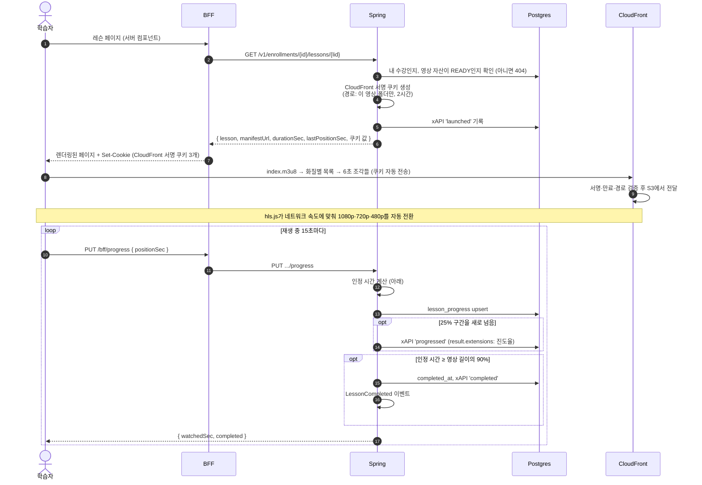

**왜 HLS에는 서명 URL이 아니라 서명 쿠키인가**
- HLS 영상 하나는 재생 목록(`.m3u8`)과 **수백 개의 6초 조각 파일**로 이뤄진다. 재생 목록 안의 조각 주소는 상대 경로라서, 파일마다 서명을 붙인 URL을 줄 수 없다.
- **서명 쿠키**는 "이 경로(`/tenants/{tid}/videos/{assetId}/*`) 아래 파일을 2시간 동안 읽어도 된다"는 정책 하나로 모든 조각을 허용한다.
- 쿠키는 BFF가 `Domain=.도메인; Path=/tenants/{tid}/videos/{assetId}/; Secure; HttpOnly`로 설정한다. **경로를 영상 폴더로 좁혀서** 다른 영상이나 다른 회사 파일에는 쓸 수 없다.
- CloudFront CORS는 `app.도메인`만 허용하고, hls.js는 쿠키를 함께 보내도록(`withCredentials`) 설정한다.
- 서명용 비밀키는 SSM Parameter Store에 두고 API만 읽는다.

**영상 길이는 `video_asset.duration_sec`(서버가 변환 결과에서 기록한 값)** 만 쓴다. 클라이언트가 보고하는 길이는 믿지 않는다.

**"끝으로 건너뛰어 수료"를 막는 인정 시간 규칙**
```
경과시간 = now - last_heartbeat_at
이동량   = positionSec - last_position_sec
인정량   = clamp(이동량, 0, 경과시간 × 2.0 + 5초)     ← 2배속 재생 + 네트워크 지연 허용
watched_sec += 인정량
```
- 정상 재생: 이동량 ≈ 경과시간 → 전부 인정
- 끝으로 건너뛰기: 이동량 1,800초, 경과 15초 → **최대 35초만 인정**
- 뒤로 감기: 인정 0, 이어보기 위치만 갱신
- 마지막 하트비트 후 30분 이상: 경과시간을 새로 시작 (탭을 닫았다 다시 연 경우)

> **한계를 먼저 말한다:** 클라이언트를 조작하면 하트비트 자체를 위조할 수 있으므로 완벽한 부정 방지는 불가능하다. 목표는 가장 쉬운 꼼수를 막고 우회 비용을 높이는 것이다. 고용보험 환급과정처럼 규제가 있는 경우엔 별도의 본인 인증·모사 방지 요건이 따라온다([08](08-cost-and-limits.md)).

**xAPI 기록이 생기는 시점**
| 동사 | 시점 |
|---|---|
| `launched` | 레슨 열기 |
| `progressed` | 25%, 50%, 75% 구간 통과 (하트비트마다 남기지 않음) |
| `completed` | 레슨 완료, 코스 수료 |
| `attempted` | 퀴즈 응시 시작 |
| `passed` / `failed` | 퀴즈 제출 결과 (`result.score.scaled`) |

**하트비트 부하:** 동시 학습자 1,000명 × 15초 ≈ 초당 67건의 작은 UPDATE. Postgres로 충분하다. 더 커지면 Redis에 모았다가 주기적으로 일괄 반영한다.

---

## 9. 퀴즈 응시, 채점, 수료

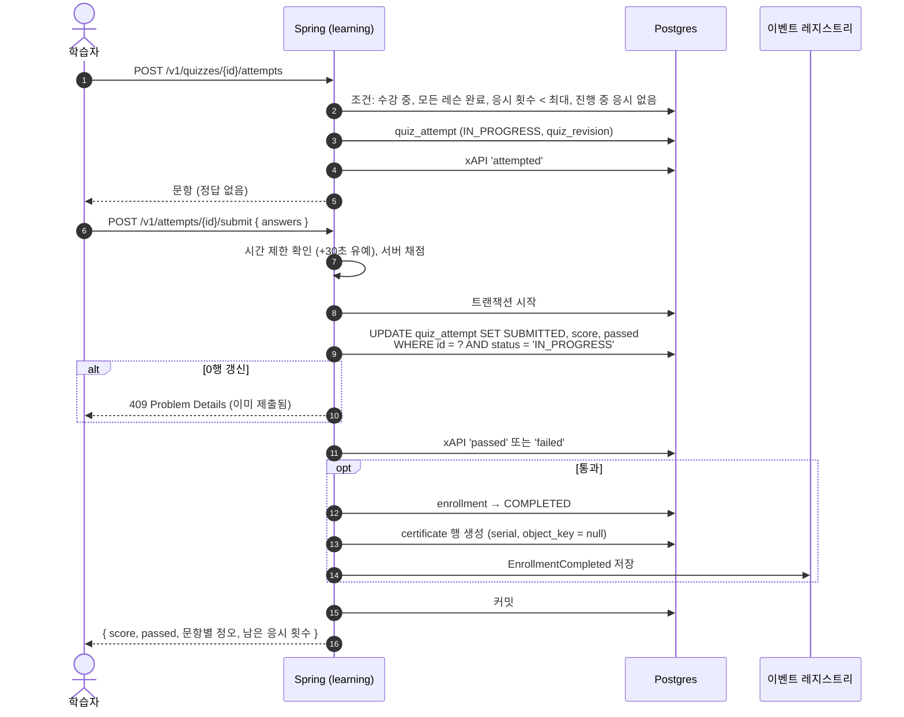

**설명**
- **채점은 서버에서만** 한다. 정답이 클라이언트로 가지 않는다.
- **조건부 UPDATE로 중복 제출을 막는다.** 버튼을 두 번 누르거나 재전송돼도 채점은 한 번만 반영된다.
- **수료 처리와 수료증 행 생성, 이벤트 저장이 한 트랜잭션**이다. "수료는 됐는데 수료증이 영원히 안 생기는" 상태가 불가능하다.
- `EnrollmentCompleted` 이벤트를 `certificates`(생성 요청), `records`(코스 xAPI `completed`), `audit`, `notification` 모듈이 각자 구독한다([03](03-architecture.md) §5). `learning` 모듈은 구독자를 모른다.
- 퀴즈가 없는 코스는 마지막 레슨 완료(`LessonCompleted`) 때 같은 수료 로직을 탄다.

---

## 10. 수료증 생성 (아웃박스 → SQS → 워커)

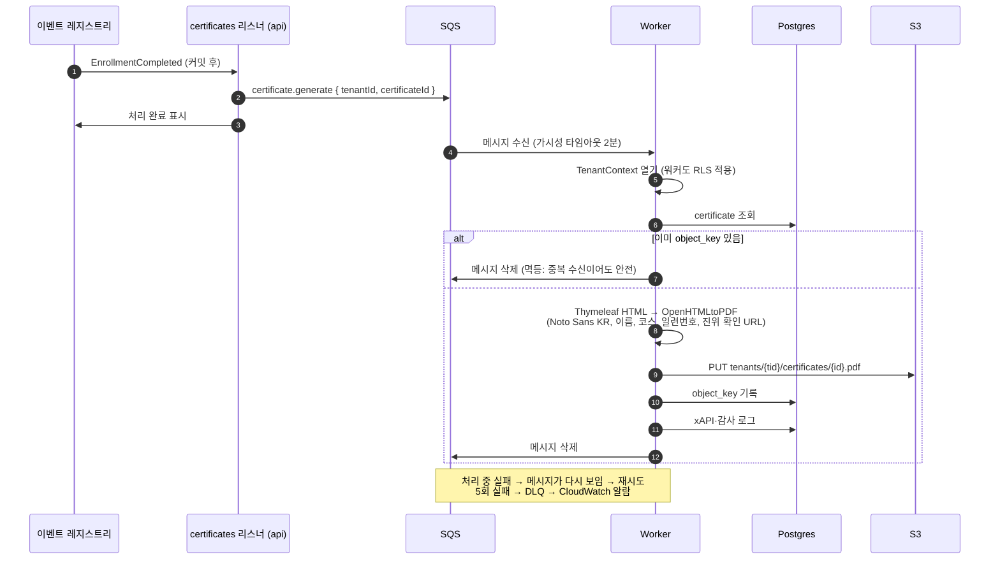

**설명**
- **두 단계 안전장치:** ① 이벤트 레지스트리는 SQS 발행이 실패하면 재시도한다(커밋된 이벤트는 사라지지 않는다). ② SQS는 처리 중 워커가 죽으면 메시지를 다시 보여준다.
- **멱등성:** SQS는 "최소 한 번 전달"이라 같은 메시지가 두 번 올 수 있다. `object_key` 존재 여부로 이미 처리했는지 확인한다.
- **DLQ:** 계속 실패하는 메시지(예: 폰트 파일 누락)가 큐를 막지 않도록 따로 빼고 알림을 보낸다. 원인을 고친 뒤 DLQ 메시지를 원래 큐로 되돌려 재처리한다.
- **진위 확인:** 수료증의 `https://app.도메인/verify/CERT-7F3K-9QX2` 링크 → 공개 페이지 → `SECURITY DEFINER` 함수가 이름(일부 마스킹), 코스명, 수료일만 반환한다.

---

## 11. 관리자 대시보드

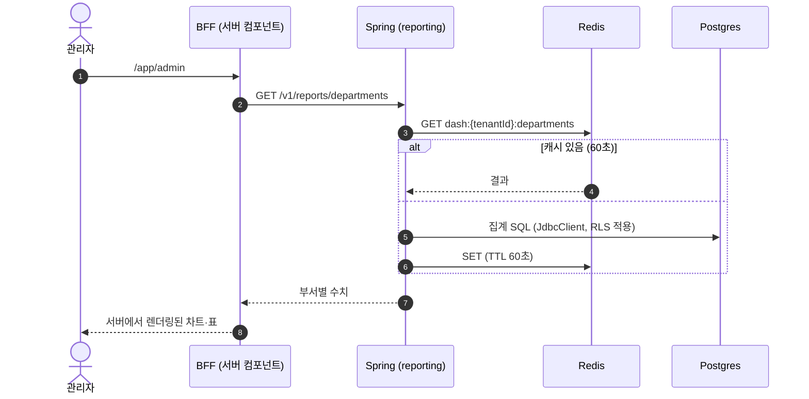

```sql
-- 부서별 수료 현황 (RLS가 현재 테넌트만 남긴다)
SELECT d.id, d.name,
       COUNT(e.id)                                         AS total,
       COUNT(*) FILTER (WHERE e.status = 'COMPLETED')      AS completed,
       COUNT(*) FILTER (WHERE e.status <> 'COMPLETED'
                          AND e.due_at < now())            AS overdue,
       ROUND(100.0 * COUNT(*) FILTER (WHERE e.status = 'COMPLETED')
             / NULLIF(COUNT(e.id), 0), 1)                  AS completion_rate
FROM department d
LEFT JOIN membership m ON m.department_id = d.id AND m.status = 'ACTIVE'
LEFT JOIN enrollment e ON e.membership_id = m.id
GROUP BY d.id, d.name
ORDER BY completion_rate NULLS LAST;
```

- 집계는 JPA보다 **SQL이 명확**하다. `FILTER` 절로 한 번 훑으면서 여러 수치를 계산한다.
- **캐시 키에 tenantId가 반드시 들어간다.** 캐시도 격리 대상이다.
- 60초 지연은 업무상 문제가 없고, 새로고침 연타에도 DB가 버틴다. 의도적 트레이드오프다.
- 확장: 데이터가 커지면 매일 밤 요약 테이블을 미리 계산하거나, xAPI 기록을 분석용 저장소(데이터 웨어하우스)로 내보낸다.

---

## 12. 예약 작업

| 작업 | 주기 | 방식 |
|---|---|---|
| 마감 임박 리마인더 | 매일 09:00 KST | 테넌트마다 컨텍스트 열기 → 3일 이내 미수료자 → 메일 메시지를 SQS로 |
| 수동 리마인더 | 관리자 클릭 | 배정당 하루 1회 제한 |
| 고아 파일 정리 | 매일 새벽 | 24시간 지난 PENDING 파일 삭제 |
| 미완료 이벤트 재발행 | 5분마다 | Modulith 이벤트 레지스트리에서 완료되지 않은 이벤트 재시도 |
| Keycloak 정합성 점검 | 매일 | DB에 없는 Keycloak 조직, Keycloak에 없는 멤버십 보고 |

- 모든 작업은 `@Scheduled` + **ShedLock**: 서버가 여러 대여도 한 대에서만 실행된다.
- **"마감 3일 전" 지연 메시지를 배정마다 예약하지 않은 이유:** 마감일이 바뀌거나 배정이 취소되면 예약을 찾아 고쳐야 한다. **매일 "지금의 사실"을 조회**하면 동기화가 필요 없고, 실패해도 다음 날 다시 돈다.
- 테넌트마다 따로 처리하므로 한 회사에서 실패해도 다른 회사에 영향이 없다.
