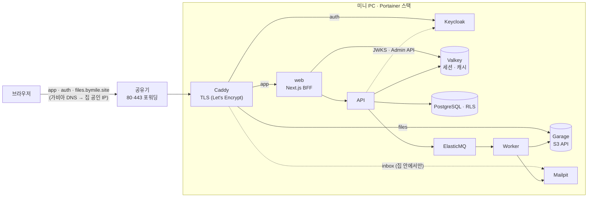

# 11. 실제 배포: 미니 PC 한 대 (Docker + Caddy + Garage)

> AWS 설계([03](03-architecture.md), [Terraform](../infra/terraform/README.md))는 "규모가 커지면 가는 길"로 남겨 두고, 지금 `bymile.site`는 **집의 미니 PC 한 대**에서 운영한다. 외부 서비스 계정이 하나도 필요 없고 비용은 전기료뿐이다. 앱 코드는 같고 환경변수만 다르다. 운영 순서는 [infra/home](../infra/home/README.md)에 있다.

## 1. 구성

| 역할 | AWS 설계 | 홈 배포 | 바뀌지 않은 것 |
|---|---|---|---|
| 입구 | ALB + ACM | Caddy (Let's Encrypt) | TLS는 입구에서 끝나고 안쪽은 HTTP |
| 웹 | ECS + ALB | 컨테이너 | BFF 구조: 토큰은 서버에만, 브라우저는 세션 쿠키만 |
| API 입구 | 공개 주소 없음 | 공개 주소 없음 (Docker 내부망) | "BFF 말고는 API에 못 들어온다" |
| 파일 | S3 + CloudFront | Garage | S3 API, presigned 업로드·다운로드, 바이트가 앱 서버를 지나지 않음 |
| 세션·캐시 | ElastiCache | Valkey | Redis 프로토콜 |
| 나머지 | RDS, SQS, SES, ECS | 같은 이미지의 컨테이너 | RLS, 아웃박스, DLQ, ShedLock, 멱등 처리 |

## 2. 선택과 이유, 버린 대안

### 왜 한 대에 전부인가
- **이전 안**은 웹을 Vercel에, 백엔드를 미니 PC에 두고 그 앞을 Cloudflare(Tunnel·Access·R2)가 지키는 구성이었다(커밋 `25be272`).
- 그 구성은 웹이 집 밖에 있어서 생기는 일이 많았다.
  - API에 공개 주소가 필요했고, 이를 막으려면 Access 서비스 토큰이 필요했다.
  - Vercel 함수가 접속할 외부 세션 저장소(Upstash)가 필요했다.
  - 계정 세 개(Cloudflare, Vercel, Upstash)와 토큰, Terraform 상태 파일 안의 비밀값까지 관리해야 했다.
- 웹까지 한 대에 두면 이 문제들이 **구조적으로** 사라진다. API는 Docker 내부망에서만 불리므로 공개 주소가 없다. 세션은 스택 안의 Valkey에 둔다. AWS 설계의 원칙(API는 공개 입구가 없다)을 장치 없이 지킨다.
- **포기한 것:** Vercel의 배포 편의(머지하면 배포, 버튼 롤백). 대신 이미지 태그 하나를 바꾸는 롤백을 쓴다.

### 입구: Caddy + 공유기 포트포워딩
- Caddy는 설정 몇 줄로 **Let's Encrypt 인증서를 자동 발급·갱신**하고, HTTP를 HTTPS로 넘기고, HTTP/3도 켠다.
- 스택에서 포트를 여는 컨테이너는 Caddy 하나다. DB, 큐, 캐시, API는 밖에서 들어올 길이 없다.
- **버린 대안**
  - Nginx + certbot: 인증서 갱신을 따로 돌려야 하고 설정이 길다.
  - Traefik: Docker 라벨 방식이 강력하지만, 서비스가 고정된 스택에서는 Caddyfile 한 장이 읽기 쉽다.
  - Cloudflare Tunnel: 포트를 열지 않는 장점이 있지만, 외부 계정과 DNS 이전이 필요하다(사용자 결정으로 제외).
- **대가**
  - 집 공인 IP가 DNS에 나온다.
  - 가정용 회선은 IP가 바뀔 수 있다. 공유기 DDNS 이름을 CNAME으로 가리키면 따라간다.

### 컨테이너가 공개 이름을 부를 때: 네트워크 별칭
- web은 Keycloak을 `https://auth.bymile.site`로, API는 저장소를 `https://files.bymile.site`로 부른다.
  - 토큰 발급자(`iss`)가 하나여야 하기 때문이다.
  - presigned URL은 API가 접속한 주소로 서명되기 때문이다.
- Caddy 컨테이너에 그 이름들을 **Docker 네트워크 별칭**으로 붙였다. 컨테이너 안에서는 이 이름이 공유기를 거치지 않고 바로 Caddy로 간다. 인증서도 브라우저가 보는 것과 같다.
- 공유기의 NAT 루프백(집 안에서 자기 공인 IP로 접속하는 기능)에 기대지 않는다.

### 파일: Garage
- 인터넷에 여는 S3 서버는 **서명을 검사해야** 한다. 로컬의 S3Mock은 검사하지 않으므로 쓸 수 없다.
- MinIO 커뮤니티판은 2025년 10월부터 바이너리와 Docker 이미지 배포를 멈추고 유지보수 모드에 들어갔다. 패치가 끊긴 이미지를 인터넷에 열 수는 없다.
- **Garage**를 골랐다.
  - S3 API를 구현한다(서명 검증, presigned URL, 멀티파트).
  - 단일 바이너리이고, 공식 이미지가 `FROM scratch`라 바이너리 말고는 아무것도 없다.
  - 작게 자체 운영하는 용도로 만들어졌다.
- 코드 변경은 **엔드포인트와 키**뿐이다(`StorageConfig`). AWS에서는 같은 코드가 태스크 역할로 S3에 접속한다.
- 초기화(노드 배치, 접근 키, 버킷)는 1회성 컨테이너 `storage-init`이 admin API v2로 한다. 매 배포마다 돌아도 이미 된 일은 건너뛴다.
- 접근 키도 `gen-stack-env.sh`가 미리 만들어 `stack.env`에 넣는다. 그래서 API와 Garage가 같은 값을 받고, 사람이 콘솔에서 복사할 일이 없다.
- CORS는 버킷 규칙 대신 Caddy에서 답한다. 앱 출처만 허용하고, 멀티파트를 위해 `ETag`를 노출한다. 설정이 한곳에 모이고 S3 호출이 필요 없다.
- **버린 대안**
  - SeaweedFS: 기능이 많지만 구성 요소(master/volume/filer)가 많다.
  - 파일을 API가 직접 받아 디스크에 쓰기: presigned 설계("바이트가 앱 서버를 지나지 않는다")를 버리게 된다.

### 관리 화면은 집 안에서만
- Keycloak 관리 콘솔(`/admin`)과 관리자 로그인(`master` 렐름), 데모 메일함은 Caddy가 **사설 IP에서 온 요청만** 통과시킨다. 밖에서는 404다.
- AWS 설계의 ALB는 `/admin`을 완전히 막는다. 여기서는 소유자가 집에서 들어갈 수 있게 했다.

### Portainer: 이미지만으로 배포
- 스택은 이미지를 받아 실행만 한다. 빌드나 저장소 파일 마운트에 기대지 않는다.
  - Caddyfile, Garage 설정, Postgres 역할 스크립트, ElasticMQ 큐 설정은 **이미지 안에** 넣었다.
  - Keycloak 렐름 파일은 비밀값과 주소를 `${ENV:개발기본값}` 자리표시자로 바꿔 넣었다.
- 스택 파일은 필수 변수를 `${NAME:?…}`로 받는다. 값이 빠지면 배포가 **실패**하고, 개발 기본값으로 조용히 뜨는 일이 없다.
- 비밀값은 `gen-stack-env.sh`가 `openssl rand`로 만들고, 이미 파일이 있으면 덮어쓰지 않는다. DB 볼륨이 옛 비밀번호를 기억하기 때문이다.
- 예외 하나: 웹 이미지의 CSP 헤더는 빌드할 때 정해진다(`next.config.ts`). 그래서 웹 이미지는 `bymile.site` 이름으로 빌드된다.

## 3. 검증한 것과 못 한 것

| 항목 | 상태 |
|---|---|
| 운영 모드 스택 리허설: 이 PC에서 같은 스택 파일, HTTP + `*.localhost` | 통과. 컨테이너 10개 기동, `storage-init`·`seed` 종료 코드 0, 수료증 PDF 22/22가 Garage에 저장됨 |
| `storage-init` 재실행 | 아무것도 바꾸지 않고 종료 (멱등) |
| 서명 없는 요청 | Garage가 403으로 거부 |
| Playwright E2E (로그인 → 레슨 → 퀴즈 → 수료, 관리자 대시보드) | 2개 통과 |
| 브라우저 업로드 (presigned PUT, CORS, CSP 그대로) | 단일 파일과 멀티파트(101 MiB, 7파트, ETag 읽기) 모두 통과 |
| 웹 `tsc`·lint, Caddyfile `validate`(https·http) | 통과 |
| 실제 배포 (2026-11-10, Portainer) | 통과. Let's Encrypt 인증서 4개 자동 발급, HTTP → HTTPS 리다이렉트, 학습자 로그인 → `auth.bymile.site` → 대시보드, 콘솔 오류 없음 |
| 바깥(LTE)에서 `/admin`·메일함 404 | 휴대폰으로 확인할 일 (집 안 PC에서는 사설 IP로 보여 열리는 것이 정상) |

## 4. 한계와 다음 단계

- **미니 PC는 단일 장애점**이다. 정전이 나거나 회선이 끊기면 서비스가 멈춘다.
- **백업이 아직 없다.** Garage도 복제본 1개(`replication_factor = 1`)라 디스크가 고장 나면 파일을 잃는다. 다음 순서로 붙인다.
  1. `pg_dump`와 Garage 버킷을 외장 디스크나 다른 장소로 보내는 정기 작업
  2. 필요하면 Garage 노드 추가
- 집 공인 IP가 DNS에 공개된다. 들어오는 길은 Caddy의 80·443뿐이고, 관리 화면은 사설 IP로 제한했다.
- ElasticMQ는 메모리 큐라서 재시작하면 대기 중인 메시지가 사라진다. 대신 아웃박스(Modulith 이벤트 레지스트리)가 미완료 이벤트를 다시 보낸다.
- 영상은 가짜 변환기(원본 mp4)다. 미니 PC에서 ffmpeg 워커로 HLS를 만들 수 있다.

## 5. 면접에서 이렇게 말한다 (1분)

> "AWS 설계는 Terraform으로 검증까지 해 두고, 실제 배포는 집 미니 PC 한 대에 했습니다. 처음에는 Vercel과 Cloudflare를 섞었는데, 웹이 집 밖에 있으니 API를 공개해야 하고 그걸 막는 장치, 외부 세션 저장소, 계정과 토큰이 줄줄이 따라왔습니다. 웹까지 한 대에 넣으니 API는 Docker 내부망에만 있게 되어서, 'API는 공개 입구가 없다'는 원칙을 장치 없이 지키게 됐습니다. 입구는 Caddy 하나로 인증서를 자동 발급하고, 파일은 서명을 검사하는 S3 호환 저장소 Garage로 옮겼는데, S3 API라서 코드는 엔드포인트와 키만 바뀌었습니다. 같은 스택을 제 PC에서 먼저 띄워 E2E와 브라우저 멀티파트 업로드까지 통과시킨 뒤에 올렸습니다."
