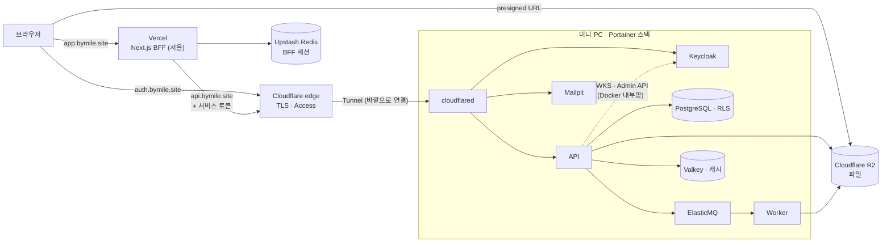

# 11. 실제 배포: Vercel + 미니 PC(Docker) + Cloudflare

> AWS 설계([03](03-architecture.md), [Terraform](../infra/terraform/README.md))는 "규모가 커지면 가는 길"로 남겨 두고, 지금 `bymile.site`는 **비용이 거의 0원인 구성**으로 실제 운영한다. 앱 코드는 같고 환경변수만 다르다. 운영 순서는 [infra/home](../infra/home/README.md)에 있다.

## 1. 구성

| 역할 | AWS 설계 | 홈 배포 | 바뀌지 않은 것 |
|---|---|---|---|
| 웹 | ECS + ALB | Vercel | BFF 구조: 토큰은 서버에만, 브라우저는 세션 쿠키만 |
| 입구 | ALB + ACM | Cloudflare Tunnel | TLS는 바깥에서 끝나고 안쪽은 HTTP |
| API 입구 | 공개 주소 없음 | Access 서비스 토큰 | "BFF 말고는 API에 못 들어온다" |
| 파일 | S3 + CloudFront | R2 | S3 API, presigned 업로드·다운로드, 바이트가 서버를 지나지 않음 |
| 세션 | ElastiCache | Upstash | Redis 프로토콜 (`rediss://`) |
| 나머지 | RDS, SQS, SES, ECS | 같은 이미지의 컨테이너 | RLS, 아웃박스, DLQ, ShedLock, 멱등 처리 |

## 2. 선택과 이유, 버린 대안

### 왜 Vercel인가
- **선택 이유**
  - Next.js를 만든 곳이라 설정이 거의 없다(`root_directory`만 지정).
  - `main`에 머지하면 배포되고, 롤백은 이전 배포를 *Promote*하는 버튼 하나다.
  - 스타트업에서 흔히 쓰는 조합이기도 하다.
- **코드 확인 결과**
  - 업로드는 브라우저 → 저장소 presigned URL이라 Vercel 함수의 **요청 본문 4.5MB 제한**에 걸리지 않는다.
  - 수료증은 presigned 링크로 302 리다이렉트하므로 응답 크기 문제도 없다.
- **버린 대안**
  - 미니 PC에서 웹까지 운영: 가능하지만 웹 배포 경험이 "또 하나의 컨테이너"로 끝난다.
  - AWS ECS: 월 $140 수준.

### 미니 PC를 어떻게 여나: Cloudflare Tunnel
- 미니 PC의 `cloudflared`가 **바깥으로** Cloudflare에 연결하고, 요청은 그 연결을 타고 들어온다.
- 공유기 포트포워딩이 없고, 집 IP가 DNS에 나오지 않으며, 유동 IP여도 상관없다.
- TLS 인증서도 Cloudflare가 처리한다.
- **버린 대안:** 포트포워딩 + Caddy(Let's Encrypt). 집 IP가 공개되고, DDNS가 필요하고, 공격 표면이 미니 PC로 바로 온다.
- **대가:** DNS를 Cloudflare로 옮겨야 한다. 가비아는 등록만 하고, 네임서버를 Cloudflare로 바꾼다.

### API를 공개해도 되나: Cloudflare Access 서비스 토큰
- Vercel이 집 밖에 있으니 API에 공개 이름(`api.bymile.site`)이 필요해졌다.
- AWS 설계의 "API는 공개 주소가 없다"를 지키려고, **Cloudflare 엣지에서** 서비스 토큰이 없는 요청을 막는다.
- BFF만 `CF-Access-Client-Id/Secret` 헤더를 보낸다(`apps/web/src/server/upstream.ts`). 미니 PC에는 토큰 없는 요청이 도달조차 하지 않는다.
- API는 여전히 JWT와 RLS로 스스로 검증한다(계층 방어).
- **버린 대안**
  - IP 허용 목록: Vercel의 고정 IP는 유료다.
  - 앱 안의 공유 비밀 헤더: 막는 위치가 미니 PC 안이라, 요청이 이미 집까지 들어온 뒤다.

### 파일은 왜 R2인가 (미니 PC가 아니라)
- 인터넷에 여는 S3 서버는 **서명을 검사해야** 한다. 로컬의 S3Mock은 검사하지 않는다.
- 계속 패치되어야 하는데, MinIO 커뮤니티판은 지원이 끝났다.
- 영상 바이트가 집 업로드 대역폭을 지나는 것도 문제다.
- R2는 S3 API라서 코드 변경이 **엔드포인트와 키 두 개**뿐이다(`StorageConfig`). 다운로드 요금도 없다(CloudFront를 둔 이유와 같은 효과).
- **버린 대안:** Garage나 SeaweedFS를 미니 PC에서 직접 운영하는 것. 가능하지만 초기화 스크립트, 운영 부담, 대역폭 문제가 있다.

### 세션은 왜 Upstash인가
- Vercel 함수는 상태를 들고 있지 않으므로, BFF 세션(토큰)은 외부 Redis에 둔다.
- **버린 대안**
  - 미니 PC의 Valkey를 공개: Redis를 인터넷에 여는 것은 위험하다.
  - 세션을 암호화 쿠키에 통째로 저장: 토큰 세 개가 쿠키 크기 한도에 가깝고, 서버에서 즉시 폐기(로그아웃)할 수 없다.

### Keycloak 주소 문제 (로컬에서 미뤘던 것)
- **문제:** 브라우저와 Vercel은 `https://auth.bymile.site`로, API 컨테이너는 Docker 내부망(`http://keycloak:8080`)으로 Keycloak을 본다. 토큰의 발급자(`iss`)는 하나여야 한다.
- **해결 두 가지**
  - Keycloak: `KC_HOSTNAME=https://auth.bymile.site` + `KC_HOSTNAME_BACKCHANNEL_DYNAMIC=true`. 내부망으로 들어온 요청에도 같은 발급자로 토큰을 발급한다.
  - API: `home` 프로필에서 `jwk-set-uri`를 내부 주소로 지정한다. 서명 키는 내부망으로 가져오고, `iss` 검사는 공개 발급자로 그대로 한다.
- 이 덕분에 API가 자기 인증 서버를 만나려고 인터넷을 한 바퀴 돌지 않는다.
- 로컬에서 "`compose --profile full`"로 미뤄 뒀던 문제가 이것으로 풀렸다.

### Portainer: 이미지만으로 배포
- Portainer 스택은 이미지를 받아 실행만 하고, 빌드나 저장소 파일 마운트에 기대지 않게 했다.
  - Postgres 역할 생성 스크립트와 ElasticMQ 큐 설정은 **이미지 안에** 넣었다.
  - Keycloak 렐름 파일은 비밀값과 주소를 `${ENV:개발기본값}` 자리표시자로 바꿔 이미지에 넣었다. 기동할 때 환경변수로 채워진다.
- 스택 파일은 필수 변수를 `${NAME:?…}`로 받는다. 값이 빠지면 배포가 **실패**하고, 이미지에 남은 개발 기본값으로 조용히 뜨는 일이 없다.
- 미니 PC는 포트를 하나도 열지 않는다. 들어오는 길은 터널뿐이다.

## 3. 검증한 것과 못 한 것

| 항목 | 상태 |
|---|---|
| 운영 모드 스택 리허설 (이 PC에서 같은 이미지·같은 스택, 터널 대신 localhost, R2 대신 S3Mock) | 통과: 운영 모드 Keycloak 기동, 렐름 자리표시자 치환, Postgres 역할 생성, 시드, 워커의 수료증 PDF 23/23, 메일 |
| Playwright E2E를 리허설 스택에 실행 (로그인 → 레슨 → 퀴즈 → 수료, 관리자 대시보드) | 2개 통과. BFF가 Access 헤더를 붙인 상태로 |
| 백엔드 테스트 | 82개 통과 |
| 웹 프로덕션 빌드 (홈 설정값으로) | 통과 |
| Terraform `validate`·`fmt` (Cloudflare v5, Vercel v3, Upstash v2) | 통과 |
| 실제 Cloudflare·Vercel·Upstash 적용, 터널 연결, R2 CORS | 계정과 토큰이 필요해서 사용자 단계 |

## 4. 한계와 다음 단계

- **Vercel Hobby는 비상업용**이다. 실제 고객이 생기면 Pro($20/월)나 AWS 설계로 간다.
- **미니 PC는 단일 장애점**이다. 정전이 나거나 회선이 끊기면 서비스가 멈춘다. DB 백업은 `pg_dump`를 R2에 올리는 정기 작업으로 붙일 수 있다(아직 안 함).
- ElasticMQ는 메모리 큐라서 재시작하면 대기 중인 메시지가 사라진다. 대신 아웃박스(Modulith 이벤트 레지스트리)가 미완료 이벤트를 다시 보낸다.
- 영상은 가짜 변환기(원본 mp4)다. 미니 PC에서 ffmpeg 워커로 HLS를 만들 수 있다.

## 5. 면접에서 이렇게 말한다 (1분)

> "AWS 설계는 Terraform으로 검증까지 해 두고, 실제 배포는 비용을 거의 안 쓰는 구성으로 했습니다. 프론트는 Vercel, 백엔드는 집 미니 PC의 Docker이고, 그 앞을 Cloudflare가 지킵니다. 공유기 포트는 하나도 열지 않았고 Cloudflare Tunnel이 바깥으로 연결합니다. Vercel이 집 밖에 있어서 API에 공개 주소가 생겼는데, Cloudflare Access 서비스 토큰으로 BFF만 들어오게 해서 AWS 설계의 'API는 공개 입구가 없다'는 원칙을 엣지에서 지켰습니다. 파일은 서명을 검사하지 않는 로컬 S3 대체품을 인터넷에 열 수 없어서 R2로 옮겼는데, S3 API라서 코드는 엔드포인트와 키만 바뀌었습니다. 같은 이미지로 운영 모드 스택을 먼저 제 PC에서 리허설하고 E2E를 통과시킨 뒤에 올렸습니다."
